# Design Document — bliblitalk-admin

> Design-review document for the Tech Architecture Group. Generated by the `design-document` skill from
> the codebase and the docs in this repo, then completed by the project owner. Companion to `PROJECT.md`
> (go-live dossier, now completed for this repo) and `docs/ARCHITECTURE.md` (as-built architecture, still
> not written) — see §0 below for how this document was produced.
>
> **⚠️ STALE as of 2026-08-02 — written before the repo-split (Phases 0–5, this repo's own
> `CONTEXT.md`).** Every mention of `/api/public/*` or `routes/public/*` below describes code that has
> since moved to `bliblitalk-user-fe`'s own backend; this repo now serves admin-only routes. Needs a
> full regeneration via the `design-document` skill (diagrams re-derived from the current code) before
> the pending independent review (task: admin — Independent review) relies on it.

## 0. Scope of this document

BlibliTalk 2.0 is split across **two separate git repositories**. This document covers **`bliblitalk-admin`
only** — the Express + Prisma backend (sole data owner) and the admin CMS React frontend. It was originally
written to cover both repos in one file; as of P8 Task 8, `bliblitalk-user-fe` has its own
`docs/DESIGN.md` covering that repo's own scope, so this document's authority is narrowed to
`bliblitalk-admin`. It still references `bliblitalk-user-fe` throughout where relevant — as an external
consumer of this repo's public API — the same way any design doc describes its dependents, not because
this document claims to cover that repo's own internals.

| Repo | Path | What it is | Ports (dev) |
|---|---|---|---|
| `bliblitalk-admin` | `D:\BlibliTalk-2.0\bliblitalk-admin` | Express + Prisma backend (sole data owner) **and** the admin CMS React frontend — **this document's scope** | backend `:4001`, admin FE `:5184` |
| `bliblitalk-user-fe` | `D:\BlibliTalk-2.0\bliblitalk-user-fe` | Public participant-facing React portal — **no backend, no database, no secrets of its own**; a pure consumer of `bliblitalk-admin`'s public API. Has its own `docs/DESIGN.md`, `PROJECT.md`, and `docs/REMEDIATION.md`. | `:5183` |

This repo now has its own `PROJECT.md` (go-live dossier, risk level High, review evidence recorded) and
`docs/REMEDIATION.md` (security/dependency remediation backlog) — both completed during P8. `docs/ARCHITECTURE.md`,
`docs/API.md`, `docs/SECURITY.md`, and `docs/DEPENDENCIES.md` still do not exist, so the sections below
that would normally draw on them were reverse-engineered directly from source and migrations, with
`file:line` evidence. ⚠️ marks everything that only the project owner can confirm.

**Repo state this document describes:** phases **P1–P7** of the event-lifecycle overhaul (transition
engine, scheduler, admin lifecycle UI, participant badge matrix, category taxonomy, create-event form
restructure, backfill/reconciliation) are **complete**. **P8** (QA hardening & go-live gate) is
**in progress**: governance scaffold, risk classification, the security + dependency audit, and closing
its BLOCKING findings (including SEC-024, a cross-repo authentication-bypass finding surfaced by
`bliblitalk-user-fe`'s own P8 audit) are done; the test-scenario dossier is written; independent review
and the final go-live gate (P8 Tasks 6–7) remain open. This document describes the system as it stands
partway through P8, not a P1–P5 baseline.

---

## Product Overview & Objectives

- **What it is:** BlibliTalk is Blibli's talk-series / career-development event platform. Employees and
  external participants (other companies, students, institutions) browse and register for talks/workshops,
  get shortlisted or instantly confirmed depending on the event's selection mode, get checked in on the
  day, submit structured feedback, and download a verifiable PDF certificate. `bliblitalk-admin` is the
  sole backend and hosts the admin CMS used by event administrators; `bliblitalk-user-fe` is the public
  participant portal.
  - The RBAC role set is `SUPER_ADMIN, EVENT_ADMIN, HR_TA, VIEWER, PARTICIPANT`
    (`bliblitalk-admin/apps/backend/src/db/prisma/schema.prisma:10-16`). `HR_TA` is explicitly labeled
    **"Talent Acquisition"** in the admin UI, not a generic HR/IT label
    (`apps/frontend/src/pages/roles/RolesPage.tsx:24,99`), and holds `MARKETING_MANAGE` +
    `SPEEDDATING_MANAGE` permissions (`packages/auth/src/rbac.ts:47-54`).
  - `User.employmentType` is an `INTERNAL | EXTERNAL` enum with a code comment
    *"Self-registration profile fields (Talent Engagement participants)"*
    (`schema.prisma:53-56,63,68-70`), and the public registration form asks for **Institution**
    ("company/school/organization"), **Role**, and **Years of experience**
    (`bliblitalk-user-fe/apps/frontend/src/pages/Register/RegisterPage.tsx:145-178`) — vocabulary aimed at
    external, not only internal, participants. `SiteSettings.contactEmail` defaults to
    `recruitment@blibli.com` (`schema.prisma:282-285`).
  - **Conclusion, confirmed by the owner:** BlibliTalk is best described as Blibli's talk-series /
    career-development event platform, **operationally owned by the Talent Acquisition function**,
    serving a **mixed audience of internal Blibli employees and external participants by design** — the
    institution/company field, `EXTERNAL` employment type, and recruiting-flavored branding are all
    intentional, not legacy artifacts.
- **Objectives / goals:** No company-level KPI, adoption target, NPS target, or ROI language exists
  anywhere in either repo (verified by reading both READMEs, both `TECH_STACK.md` files, and every
  `docs/superpowers/specs|plans/*.md` file) — the only "success criteria" language found is phase-level
  *technical* exit criteria for the event-lifecycle-overhaul sub-project (e.g. P2: "≤60s freshness
  verified; overdue never shows 'live'"; P3: "admin cannot trigger an invalid transition from the UI").
  **Confirmed by the owner:** the platform's business objectives are (1) **employee career development /
  talent growth** — giving Blibli staff access to structured talks/workshops that build skills and career
  progression, and (2) **recruiting / employer branding** — using the same talk-series content to engage
  and attract external candidates. No numeric target (attendance %, NPS, adoption rate) has been set for
  either objective yet.
- **PRD:** ⚠️ **Still open.** No PRD document exists as a file in either repo; a roadmap file exists
  locally at `C:\Users\david.dk\.claude\plans\resilient-skipping-meteor.md`
  ("BlibliTalk 2.0 — Event Lifecycle & Status Consistency, PRD-BLT-2.0-001") that references `§2.2`,
  `FR-1.1`-style sections of an original PRD — but that roadmap is itself a *synthesis written by a prior
  agent session*, not the source PRD text, and it lives outside both repos (a local machine path, not
  something that resolves on GitHub). The owner was unsure whether a source PRD exists elsewhere
  (Confluence/ticketing) — **recommend confirming with the wider team and linking it here before this
  document goes to review**, or explicitly stating "no PRD exists" if none is found.

---

## Business Workflow

**Intent:** Convert interest in a Blibli Talk event into a well-run session with tracked attendance,
structured feedback, and a certificate of participation — while giving the Talent Acquisition /
event-admin team control over who ultimately fills a seat (first-come-first-served, or a curated
shortlist for "hidden seat count" events) and, since the P1–P3 lifecycle-engine overhaul, full
server-enforced visibility into why an event's status is what it is at every moment. Per the owner, the
business outcomes this serves are **employee career development** and **recruiting / employer branding**
(see Product Overview); the process below is what the code proves happens, step by step.

Traced from `bliblitalk-admin/apps/backend/src/routes/public/events/events.service.ts` and
`.../public/registrations/registrations.service.ts`.

Evidence for each branch: registration eligibility and duplicate-active-registration guard
(`events.service.ts:56-113`); shortlist-vs-instant-confirm decision at
`decideInitialStatus` (`events.service.ts:115-126` — `showRemainingSeats===false` ⇒ every registrant
starts `WAITING`, else FCFS instant `REGISTERED`/`WAITING`(waitlist)/rejected-with-`EVENT_FULL`); admin
shortlist/reject/waitlist actions gated by `PARTICIPANT_SHORTLIST`
(`apps/backend/src/routes/admin/adminParticipants.routes.ts:43-88`); attendance is **admin-only**, no
participant self-check-in exists (confirmed absent in
`bliblitalk-user-fe/docs/superpowers/specs/2026-07-17-lifecycle-p4-user-fe-badge-matrix-design.md:92-93`);
feedback gated on `attendance===PRESENT` + `event.enableFeedback`, one submission only
(`registrations.service.ts` ~lines 40-74); certificate download requires `attendance===PRESENT` and,
if `enableFeedback` is on, requires feedback first (`FEEDBACK_REQUIRED` error otherwise) — certificates are
generated **lazily on first download**, not by a separate admin step, though admins can also bulk-issue
them ahead of time (`adminCertificates.service.ts:31-63`).

---

## Architecture Diagrams

### A. Component / Deployment Diagram

**Component view**

No message queue/broker, no cloud storage SDK, and no third-party SaaS integration (payments, analytics,
error-tracking) exist anywhere in either repo — confirmed by exhaustive grep across both trees (see
External Connections below). The two frontends never talk to each other directly; both talk only to the
one backend.

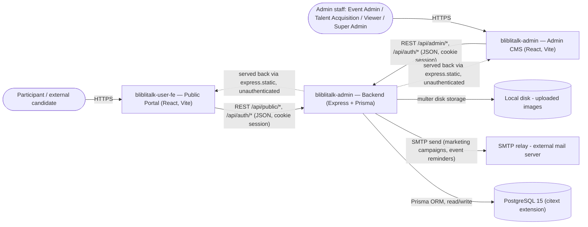

PDF certificate generation (`pdfkit`/`svg-to-pdfkit`) is deliberately **not shown as an external node** —
it is fully in-process, no network call, no external asset fetch on render
(`apps/backend/src/routes/public/registrations/certificate.pdf.ts`, `certificate.assets.ts:5`).

**Deployment & access boundary**

The apparent contradiction in the project's own docs — `TECH_STACK.md:33,106` says the backend sits
behind an **Internal** GKE Load Balancer ("admin CMS is not public-facing"), while `TECH_STACK.md:114`
says `/api/public/*` is consumed by `bliblitalk-user-fe` "over the internet" — **is resolved by the
owner as follows**: "Internal" here means **internal to Blibli's corporate network/VPN**, reachable by
any Blibli employee or connected system, not a strict GCP-VPC-only Load Balancer that would be
unreachable from a separately-hosted static frontend. The owner further confirmed: (1) `/api/admin/*` and
`/api/public/*` **should eventually be split into separate Services/Ingresses** with different exposure
levels (admin strictly corporate-network-only, public internet-facing) — this is a target-state decision,
not yet implemented; (2) **no real GKE cluster, namespace, or Load Balancer is provisioned anywhere yet**
— `k8s/README.md`'s "not wired yet" placeholder accurately reflects the current state, confirmed by the
owner, not just by the absence of manifest files; (3) the **single-fullstack-container packaging remains
the intended near-term production shape** (Express serving the built admin FE statically on one port,
per the current `Dockerfile`) — the eventual admin/public exposure split is a future evolution of this,
not a rejection of it. The diagram below reflects this current/near-term shape.

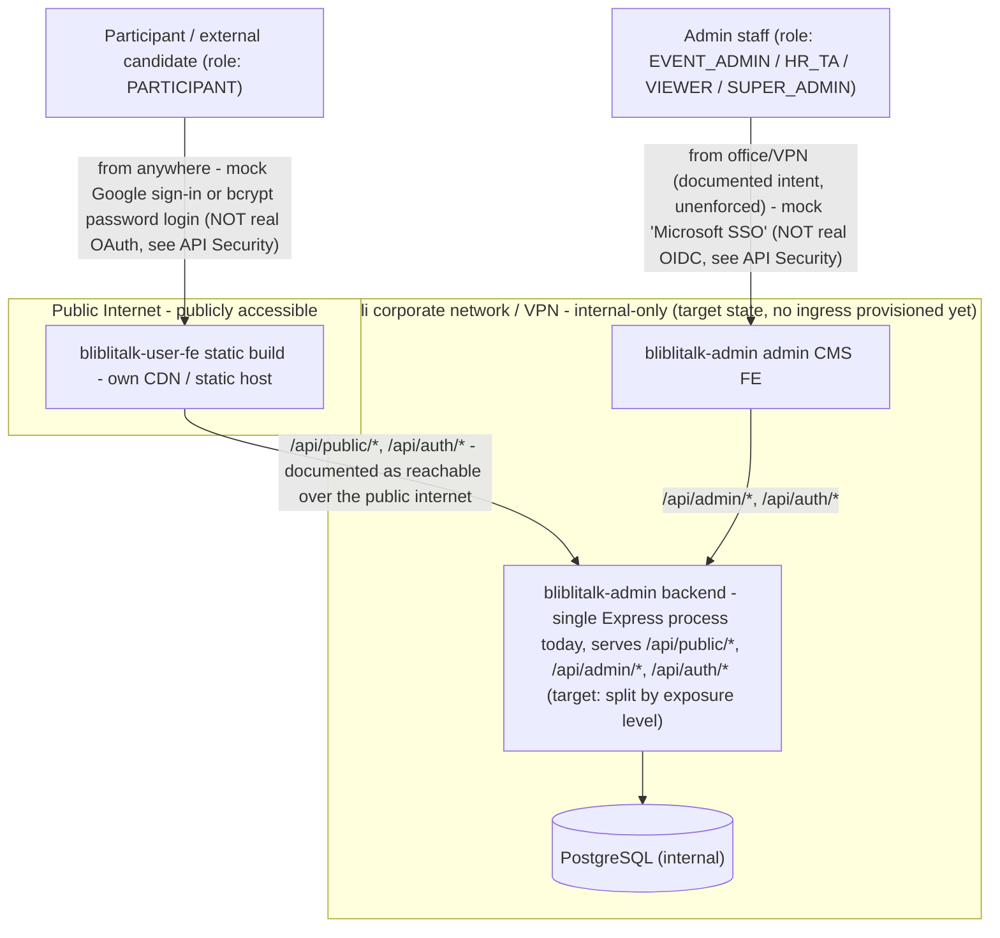

**Confirmed by the owner** (superseding the `TECH_STACK.md:104-105` unfilled `Cluster`/`Namespace`
placeholders): "internal" means Blibli's corporate network/VPN, not a strict VPC-internal boundary; the
admin/public API split into separate exposure levels is a target-state goal, not yet built; and no real
GKE cluster, namespace, or Load Balancer is provisioned anywhere today.

### B. Sequence Diagrams & System Boundaries

No financial-asset, payment, or loyalty-point flow exists anywhere in this codebase (see Financial Risks
below for the exhaustive grep proof) — **no sequence diagram in this document uses the colored-`rect`
financial highlight**, since there is nothing to highlight.

**Use case: Browse & register for an event (participant, role-based selection-mode branch)**

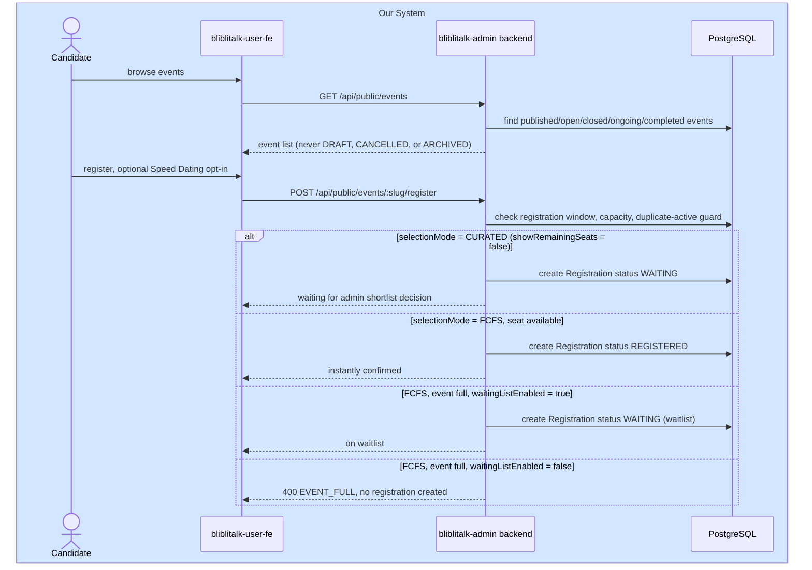

**Use case: Admin creates and publishes an event (single write path via transitionEvent)**

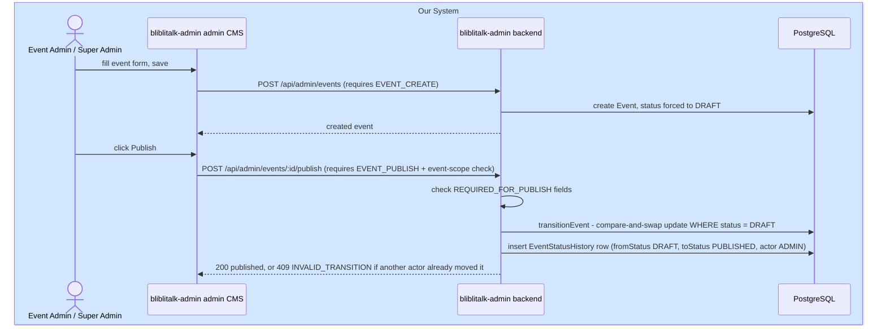

`transitionEvent` (`apps/backend/src/lib/lifecycle/transitionEvent.ts:24-89`) is documented in its own
comment as *"the ONLY code path allowed to mutate event.status"* — every admin lifecycle action
(publish/cancel/open-registration/close-registration/manual status override/generic transition) and the
scheduler below all funnel through it.

**Use case: Automated lifecycle scheduler (system-actor, no HTTP call)**

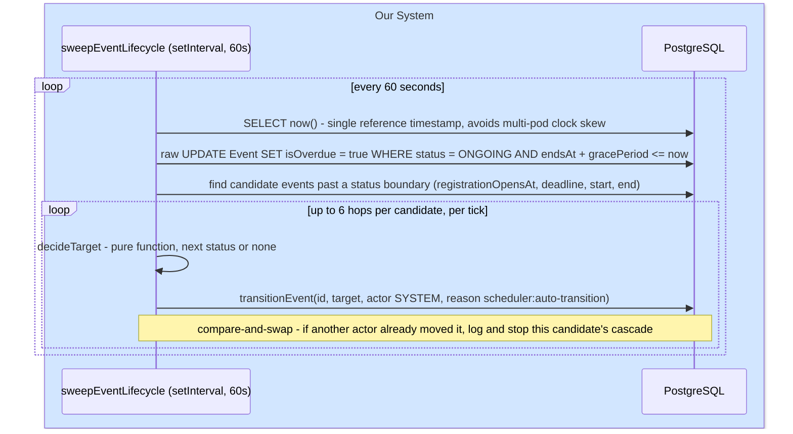

No pessimistic locking (`SELECT FOR UPDATE`, `SKIP LOCKED`, Postgres advisory locks) exists anywhere —
concurrency safety for multiple replicas comes entirely from `transitionEvent`'s own
`updateMany({where:{id,status:from}})` compare-and-swap
(`apps/backend/src/lib/lifecycle/sweepEventLifecycle.ts`, full file read; confirmed by repo-wide grep for
locking primitives returning zero code hits).

**Use case: Admin manages participants and attendance (role-based access difference)**

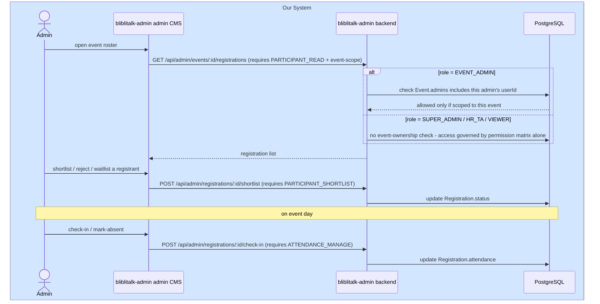

Event-scoping (`isEventScoped`, `packages/auth/src/rbac.ts:82-84`) applies **only** to `EVENT_ADMIN` —
`SUPER_ADMIN`/`HR_TA`/`VIEWER` see every event platform-wide, gated purely by the permission matrix.
⚠️ Confirm this is the intended org model (HR_TA/VIEWER as cross-event roles), not an oversight.

**Use case: Feedback submission and certificate download (gated chain)**

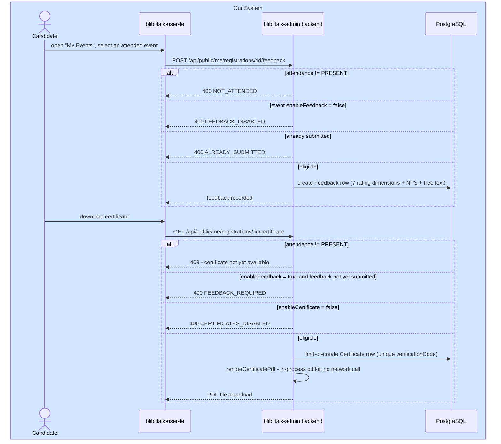

**Use case: Marketing email campaign (real SMTP integration)**

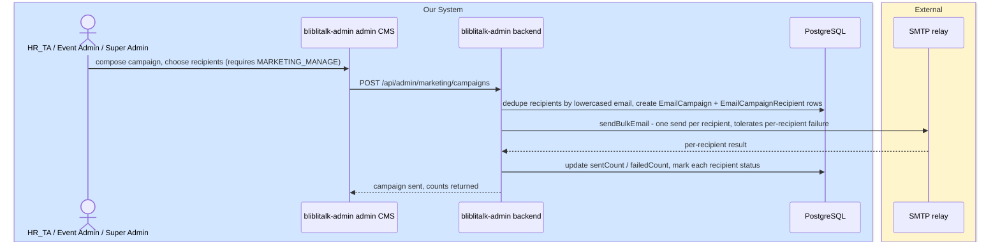

Throws `EMAIL_NOT_CONFIGURED_MESSAGE` if `SMTP_HOST` is unset (`apps/backend/src/lib/shared/mailer.ts:5-6,33`)
— the local `docker-compose.yml` sets no SMTP env vars, so email is unconfigured in that stack today.

**Use case: Event reminders — scheduled two-audience send**

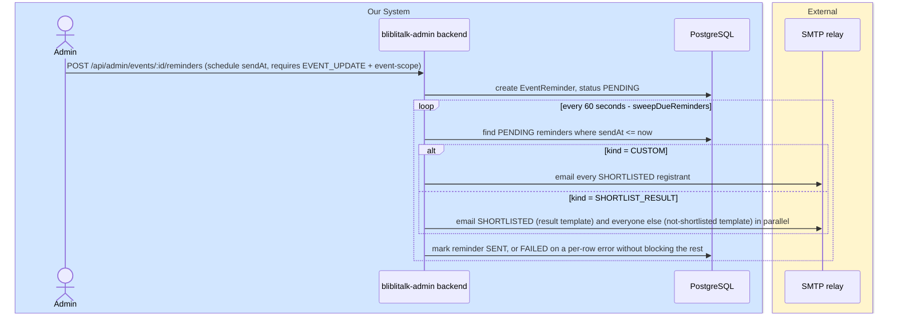

### C. Transaction / Data-Flow (no queue/broker; the closest analogue is the Event status write path)

No message queue, event stream, or broker exists anywhere in either repo (`bull|bullmq|kafka|rabbitmq|
redis|amqp` grepped across both trees, zero real hits). There is no financial transaction to track (see
Financial Risks). The closest thing to a "transaction ownership" story in this codebase is the
compare-and-swap write to `Event.status`, which the scheduler and every admin lifecycle action share as
their single write path:

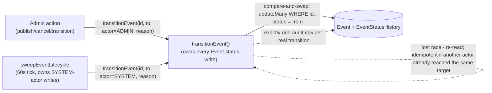

- **Transaction ownership:** `transitionEvent()` alone (`apps/backend/src/lib/lifecycle/transitionEvent.ts:24-89`)
  — CONFIRMED, its own comment states it is "the ONLY code path allowed to mutate event.status."
- **Upstream systems with access:** none — only this backend process ever writes `Event.status`; no other
  service or job touches this table.
- **Failure & recovery:** the compare-and-swap (`updateMany` guarded on current `status`) means a losing
  writer simply re-reads and either finds the target already reached (idempotent no-op) or gets a fresh
  409 reflecting the real current status — CONFIRMED, `transitionEvent.ts:50-84`. `COMPLETED` side-effects
  (clearing `isOverdue`, flipping `displayConfig.pastEvent`) run **after** commit and are never rolled back
  on failure — instead recorded as `sideEffectsStatus=FAILED` on the history row for manual follow-up
  (`transitionEvent.ts:86-113`). ⚠️ Whether a `FAILED` side-effect has ever needed manual remediation in
  practice is an owner/ops question, not something the code shows.

---

## Database Schema

Single Postgres 15 database, owned exclusively by `bliblitalk-admin`'s backend — `bliblitalk-user-fe` has
no database access of any kind (confirmed: no Prisma schema, no `DATABASE_URL` anywhere in that repo).
17 models, all in `apps/backend/src/db/prisma/schema.prisma`, plus 2 Prisma-implicit many-to-many join
tables.

```mermaid
erDiagram
    USER ||--o{ REGISTRATION : "registers"
    USER ||--o{ CERTIFICATE : "owns"
    USER ||--o{ FEEDBACK : "submits"
    USER |o--o{ OTPCHALLENGE : "requests login codes (ON DELETE CASCADE; null owner = registration code)"
    USER }o--o{ EVENT : "administers (EventAdmins)"
    USER ||--o{ EVENT : "owns (EventOwner, nullable)"
    EVENTCATEGORY ||--o{ EVENT : "categorizes"
    EVENT }o--o{ SPEAKER : "features (EventSpeakers)"
    EVENT ||--o{ REGISTRATION : "has"
    EVENT ||--o{ CERTIFICATE : "issues"
    EVENT ||--o{ FEEDBACK : "collects"
    EVENT ||--o{ EVENTREMINDER : "schedules"
    EVENT ||--o{ EVENTSTATUSHISTORY : "logs"
    REGISTRATION ||--o| SPEEDDATINGREGISTRATION : "opts into"
    REGISTRATION ||--o| FEEDBACK : "yields"
    EMAILCAMPAIGN ||--o{ EMAILCAMPAIGNRECIPIENT : "sends to"

    USER {
        string id PK
        string email UK
        string role "SUPER_ADMIN | EVENT_ADMIN | HR_TA | VIEWER | PARTICIPANT"
        string employmentType "INTERNAL | EXTERNAL"
    }
    OTPCHALLENGE {
        string id PK
        string userId FK "nullable - ON DELETE CASCADE; null while a registration code is outstanding"
        string codeHash "bcrypt - plaintext code is never stored"
        datetime expiresAt "createdAt + 15 min"
        int attempts "locks at 5"
        datetime consumedAt "nullable - consumption is an UPDATE, never a DELETE"
    }
    EVENTCATEGORY {
        string id PK
        string name UK "citext - case-insensitive unique"
        bool isActive
    }
    EVENT {
        string id PK
        string slug UK
        string categoryId FK
        string ownerId FK "nullable, ON DELETE SET NULL"
        string status "8-state lifecycle enum"
        string selectionMode "FCFS | CURATED"
    }
    SPEAKER {
        string id PK
        string name
    }
    REGISTRATION {
        string id PK
        string userId FK
        string eventId FK
        string status "REGISTERED|WAITING|REJECTED|SHORTLISTED|CANCELLED"
        string attendance "PRESENT|ABSENT|PENDING"
    }
    SPEEDDATINGREGISTRATION {
        string id PK
        string registrationId FK "unique - enforces 1:1"
    }
    CERTIFICATE {
        string id PK
        string userId FK
        string eventId FK
        string verificationCode UK
    }
    FEEDBACK {
        string id PK
        string registrationId FK "unique - enforces 1:1"
        string userId FK
        string eventId FK
        int overallRating
        int npsScore
    }
    ANNOUNCEMENT {
        string id PK
        string title
    }
    SITESETTINGS {
        string id PK "fixed default: singleton"
        string contactEmail
    }
    MODULESETTINGS {
        string key PK
        json data
    }
    MARKETINGCONTACT {
        string id PK
        string email UK
    }
    EMAILCAMPAIGN {
        string id PK
        string subject
    }
    EMAILCAMPAIGNRECIPIENT {
        string id PK
        string campaignId FK
        string email
    }
    EVENTREMINDER {
        string id PK
        string eventId FK
        string kind "CUSTOM | SHORTLIST_RESULT"
    }
    EVENTSTATUSHISTORY {
        string id PK
        string eventId FK "ON DELETE CASCADE - the one exception to RESTRICT"
        string fromStatus "nullable"
        string toStatus
        string actorType "ADMIN | SYSTEM"
    }
```

**Table: `User`** (`schema.prisma:58-88`)

| Field | Type | Nullable | Key | Description |
|---|---|---|---|---|
| id | String (cuid) | no | PK | |
| email | String | no | UNIQUE | login identity |
| name | String | no | — | |
| role | Role enum | no, default PARTICIPANT | — | `SUPER_ADMIN\|EVENT_ADMIN\|HR_TA\|VIEWER\|PARTICIPANT`; `HR_TA` is labeled "Talent Acquisition" in the admin UI |
| employmentType | EmploymentType enum | no, default EXTERNAL | — | `INTERNAL\|EXTERNAL` |
| department | String | yes | — | |
| position | String | yes | — | |
| phone | String | yes | — | |
| avatarUrl | String | yes | — | |
| institution | String | yes | — | self-registration field, external participants (company/school/org) |
| yearsOfExperience | String | yes | — | self-registration field |
| passwordHash | String | **yes** | — | bcrypt, cost 10. Null for participant accounts created via `bliblitalk-user-fe`'s email-OTP registration (2026-08); admin-provisioned staff accounts (`adminUsers.service.ts`) always set it, and password login only ever applies to them |
| createdAt | DateTime | no, default now() | — | doubles as the registration/consent timestamp for participant self-registration (GRC audit) |

**Table: `OtpChallenge`** (`schema.prisma:97-117`)

Email one-time-code login for participants (`bliblitalk-user-fe`, 2026-08). Its own table rather
than columns on `User`, so each request is independently auditable and concurrent requests from
multiple tabs/devices cannot clobber one shared row.

A row with a null `userId` is a **registration** challenge: the account does not exist yet, and
nothing identifying the applicant is stored — not even the address the code was sent to. The
profile they typed rides in a short-lived signed token held by their browser, and the `User` row
is created only when the code comes back, so `User.createdAt` records a completed registration
rather than an abandoned attempt.

| Field | Type | Nullable | Key | Description |
|---|---|---|---|---|
| id | String (cuid) | no | PK | |
| userId | String | **yes** | FK → `User`, ON DELETE CASCADE | set for sign-in codes; null for registration codes, where no account exists yet |
| codeHash | String | no | — | bcrypt hash of the 6-digit code; the plaintext is never stored, only emailed |
| expiresAt | DateTime | no | — | `createdAt` + 15 minutes |
| attempts | Int | no, default 0 | — | wrong-code count; the challenge locks at 5 |
| consumedAt | DateTime | yes | — | set on successful verify, on lockout, and when superseded by a newer request. Consumption is an UPDATE, never a DELETE — the restricted `bliblitalk_public` role has no DELETE grant anywhere, by design |
| createdAt | DateTime | no, default now() | — | |

**Table: `Speaker`** (`schema.prisma:119-130`)

| Field | Type | Nullable | Key | Description |
|---|---|---|---|---|
| id | String (cuid) | no | PK | |
| name | String | no | — | |
| title | String | yes | — | |
| company | String | yes | — | |
| bioShort | String | yes | — | |
| bioLong | String | yes | — | |
| credentials | String[] | no, default [] | — | |
| avatarUrl | String | yes | — | |
| featured | Boolean | no, default false | — | |

**Table: `EventCategory`** (`schema.prisma:132-138`, added migration `20260718060000_category_taxonomy`)

| Field | Type | Nullable | Key | Description |
|---|---|---|---|---|
| id | String (cuid) | no | PK | |
| name | String @db.Citext | no | UNIQUE (case-insensitive) | requires the Postgres `citext` extension |
| isActive | Boolean | no, default true | — | soft-delete flag; never physically deleted |
| createdAt | DateTime | no, default now() | — | |

**Table: `Event`** (`schema.prisma:140-207`) — the largest table

| Field | Type | Nullable | Key | Description |
|---|---|---|---|---|
| id | String (cuid) | no | PK | |
| slug | String | no | UNIQUE | |
| eventCode | String | yes | — | |
| title | String | no | — | |
| subtitle | String | yes | — | |
| bannerUrl | String | yes | — | |
| thumbnailUrl | String | yes | — | |
| description | String | no | — | |
| categoryId | String | no | FK → EventCategory | ON DELETE RESTRICT |
| tags | String[] | no, default [] | — | |
| location | String | no | — | |
| startsAt | DateTime | no | — | |
| endsAt | DateTime | no | — | |
| capacity | Int | no, default 0 | — | 0 = unlimited |
| status | EventStatus enum | no, default DRAFT | — | 8-state lifecycle; **only** `transitionEvent()` may write this |
| statusChangedAt | DateTime | no, default now() | — | |
| isOverdue | Boolean | no, default false | — | set by the scheduler when `ONGOING` + past `endsAt + gracePeriodMinutes` |
| gracePeriodMinutes | Int | no, default 120 | — | |
| autoCompleteAfterMinutes | Int | no, default 2880 | — | |
| selectionMode | SelectionMode enum | no, default FCFS | — | `FCFS\|CURATED`; backfilled historically from `showRemainingSeats` (⚠️ heuristic, not a verified historical record) |
| hasSpeedDating | Boolean | no, default false | — | |
| featured | Boolean | no, default false | — | |
| recommended | Boolean | no, default false | — | |
| ownerId | String | yes | FK → User | ON DELETE SET NULL |
| showRemainingSeats | Boolean | no, default true | — | `false` ⇒ "shortlist-only" UX + backfilled `selectionMode=CURATED` |
| enableCertificate | Boolean | no, default true | — | |
| enableFeedback | Boolean | no, default false | — | |
| waitingListEnabled | Boolean | no, default true | — | |
| registrationOpensAt | DateTime | yes | — | |
| publishedAt | DateTime | yes | — | |
| venue | String | yes | — | |
| mapsUrl | String | yes | — | |
| registrationDeadline | DateTime | yes | — | |
| eventType | String | yes | — | |
| dressCode | String | yes | — | |
| language | String | yes | — | |
| organizedBy | String | yes | — | |
| importantNotes | String | yes | — | |
| learningPoints | Json | no, default [] | — | |
| discussionPoints | Json | no, default [] | — | |
| agenda | Json | no, default [] | — | |
| faqs | Json | no, default [] | — | |
| galleryImages | String[] | no, default [] | — | |
| recordingUrl | String | yes | — | |
| presentationUrl | String | yes | — | |
| displayConfig | Json | no, default (object) | — | per-event display toggles |

Indexes: `@@index([status, registrationOpensAt])`, `@@index([status, registrationDeadline])`,
`@@index([status, startsAt])`, `@@index([status, endsAt])` — added specifically to serve the scheduler's
candidate-fetch queries (migration `20260716105058_lifecycle_scheduler_indexes`).

**Table: `Registration`** (`schema.prisma:209-226`)

| Field | Type | Nullable | Key | Description |
|---|---|---|---|---|
| id | String (cuid) | no | PK | |
| userId | String | no | FK → User | ON DELETE RESTRICT |
| eventId | String | no | FK → Event | ON DELETE RESTRICT |
| status | RegistrationStatus enum | no, default REGISTERED | — | `REGISTERED\|WAITING\|REJECTED\|SHORTLISTED\|CANCELLED` |
| attendance | Attendance enum | no, default PENDING | — | `PRESENT\|ABSENT\|PENDING`, admin-set only |
| shortlistedAt | DateTime | yes | — | |
| checkedInAt | DateTime | yes | — | |
| cancelledAt | DateTime | yes | — | |
| createdAt | DateTime | no, default now() | — | |

Constraint: `@@unique([userId, eventId])` — one registration per user per event (a cancelled one may be
re-created; `REJECTED` is terminal).

**Table: `SpeedDatingRegistration`** (`schema.prisma:228-234`)

| Field | Type | Nullable | Key | Description |
|---|---|---|---|---|
| id | String (cuid) | no | PK | |
| registrationId | String | no | FK+UNIQUE → Registration | enforces 1:1; ON DELETE RESTRICT |
| sessionInfo | String | yes | — | |
| status | String | no, default "PENDING" | — | plain string, not a DB enum |

**Table: `Announcement`** (`schema.prisma:236-242`)

| Field | Type | Nullable | Key | Description |
|---|---|---|---|---|
| id | String (cuid) | no | PK | |
| title | String | no | — | |
| body | String | no | — | |
| publishedAt | DateTime | no, default now() | — | |
| pinned | Boolean | no, default false | — | |

**Table: `Certificate`** (`schema.prisma:244-252`)

| Field | Type | Nullable | Key | Description |
|---|---|---|---|---|
| id | String (cuid) | no | PK | |
| userId | String | no | FK → User | ON DELETE RESTRICT |
| eventId | String | no | FK → Event | ON DELETE RESTRICT |
| issuedAt | DateTime | no, default now() | — | |
| verificationCode | String | no | UNIQUE | |

**Owner-confirmed:** the absence of a unique constraint on `(userId, eventId)` is **intentional** —
re-issuance (a participant legitimately holding more than one certificate row for the same event, each
with its own `verificationCode`) is a real, supported scenario, not an oversight.

**Table: `Feedback`** (`schema.prisma:257-279`)

| Field | Type | Nullable | Key | Description |
|---|---|---|---|---|
| id | String (cuid) | no | PK | |
| registrationId | String | no | FK+UNIQUE → Registration | enforces 1:1 |
| userId | String | no | FK → User | |
| eventId | String | no | FK → Event | |
| overallRating | Int | no | — | comment claims 1–10; ⚠️ **not enforced by any DB CHECK constraint** |
| topicRating | Int | no | — | same caveat |
| qnaRating | Int | no | — | same caveat |
| contentRating | Int | no | — | same caveat |
| speakerRating | Int | no | — | same caveat |
| venueRating | Int | no | — | same caveat |
| timingRating | Int | no | — | same caveat |
| npsScore | Int | no | — | comment claims 0–10; same caveat |
| takeaway | String | yes | — | |
| topicsWanted | String | yes | — | |
| speakerWanted | String | yes | — | |
| comments | String | yes | — | |
| createdAt | DateTime | no, default now() | — | |

**Table: `SiteSettings`** (`schema.prisma:282-285`) — singleton row

| Field | Type | Nullable | Key | Description |
|---|---|---|---|---|
| id | String | no, default "singleton" | PK | singleton pattern by convention only, not DB-enforced |
| contactEmail | String | no, default "recruitment@blibli.com" | — | |

**Table: `ModuleSettings`** (`schema.prisma:290-294`) — generic per-module JSON config store

| Field | Type | Nullable | Key | Description |
|---|---|---|---|---|
| key | String | no | PK | convention keys: `speed_dating`, `feedback`, `certificate`, `login_carousel_admin`, `login_carousel_portal` |
| data | Json | no | — | |
| updatedAt | DateTime | no, @updatedAt | — | |

**Table: `MarketingContact`** (`schema.prisma:298-304`)

| Field | Type | Nullable | Key | Description |
|---|---|---|---|---|
| id | String (cuid) | no | PK | |
| email | String | no | UNIQUE | |
| name | String | yes | — | |
| source | String | no, default "manual" | — | `"manual"\|"registrant"` per comment, not DB-enforced |
| createdAt | DateTime | no, default now() | — | |

⚠️ No FK relation to `User`/`Registration` despite a schema comment describing this as synced from past
registrants — confirm whether this decoupling is intentional (contacts can outlive/predate a `User` row).

**Table: `EmailCampaign`** (`schema.prisma:306-316`)

| Field | Type | Nullable | Key | Description |
|---|---|---|---|---|
| id | String (cuid) | no | PK | |
| subject | String | no | — | |
| bodyHtml | String | no | — | |
| createdAt | DateTime | no, default now() | — | |
| sentAt | DateTime | yes | — | |
| recipientCount | Int | no, default 0 | — | |
| sentCount | Int | no, default 0 | — | |
| failedCount | Int | no, default 0 | — | |

**Table: `EmailCampaignRecipient`** (`schema.prisma:318-326`)

| Field | Type | Nullable | Key | Description |
|---|---|---|---|---|
| id | String (cuid) | no | PK | |
| campaignId | String | no | FK → EmailCampaign | ON DELETE RESTRICT |
| email | String | no | — | |
| name | String | yes | — | |
| status | String | no, default "PENDING" | — | `PENDING\|SENT\|FAILED`, plain string |
| error | String | yes | — | |

**Table: `EventReminder`** (`schema.prisma:335-351`)

| Field | Type | Nullable | Key | Description |
|---|---|---|---|---|
| id | String (cuid) | no | PK | |
| eventId | String | no | FK → Event | ON DELETE RESTRICT |
| kind | ReminderKind enum | no, default CUSTOM | — | `CUSTOM\|SHORTLIST_RESULT` |
| sendAt | DateTime | no | — | must be future at creation |
| subject | String | no | — | shortlisted-audience template |
| bodyHtml | String | no | — | shortlisted-audience template |
| subjectNotShortlisted | String | yes | — | non-shortlisted-audience template (SHORTLIST_RESULT kind only) |
| bodyHtmlNotShortlisted | String | yes | — | non-shortlisted-audience template |
| status | String | no, default "PENDING" | — | `PENDING\|SENT\|FAILED`, plain string |
| sentAt | DateTime | yes | — | |
| recipientCount | Int | no, default 0 | — | |
| sentCount | Int | no, default 0 | — | |
| failedCount | Int | no, default 0 | — | |
| createdAt | DateTime | no, default now() | — | |

**Table: `EventStatusHistory`** (`schema.prisma:353-366`) — the lifecycle audit trail, added migration
`20260716060555_lifecycle_engine`

| Field | Type | Nullable | Key | Description |
|---|---|---|---|---|
| id | String (cuid) | no | PK | |
| eventId | String | no | FK → Event | **ON DELETE CASCADE** — the one exception to RESTRICT everywhere else |
| fromStatus | EventStatus enum | yes | — | null on the very first row |
| toStatus | EventStatus enum | no | — | |
| actorType | String | no | — | `"ADMIN"\|"SYSTEM"`, plain string |
| actorId | String | yes | — | `User.id` when actorType=ADMIN, else null; no declared FK constraint |
| reason | String | yes | — | |
| sideEffectsStatus | String | no, default "PENDING" | — | `PENDING\|DONE\|FAILED\|NONE` |
| createdAt | DateTime | no, default now() | — | |

**Implicit many-to-many join tables** (Prisma-managed, both `ON DELETE CASCADE ON UPDATE CASCADE`):
`_EventSpeakers` (Event.id ↔ Speaker.id), `_EventAdmins` (Event.id ↔ User.id, added alongside the
RBAC migration).

**No CHECK constraints exist in any migration** — every `PENDING|SENT|FAILED`-style status field
(`EmailCampaignRecipient.status`, `EventReminder.status`, `EventStatusHistory.sideEffectsStatus`,
`SpeedDatingRegistration.status`) is a plain unconstrained TEXT column, validated (if at all) only in
application code.

**Schema-evolution note (owner-confirmed):** migration `20260716060555_lifecycle_engine`'s comment says
*"no data remap here — P7 handles that"* for the `EventStatus` 5→8 value expansion, and no migration
performs that remap. This is moot in the current state: **there is no legacy production data with old
5-state values to remap** — the system is greenfield/seed-only today. The P7 backfill/reconciliation
task only becomes relevant if real legacy-status data exists at the time P7 runs.

---

## External Connections & Integrations

Both repos have exactly **one real outbound-network integration** (SMTP email), one fully in-process
capability (PDF generation — explicitly **not** external), and one local-disk capability (file uploads —
explicitly **not** cloud storage). Microsoft/Google "SSO" makes **zero** real outbound network calls today
(see API Security). No queue/broker, no cloud-storage SDK, no third-party SaaS SDK (payments, analytics,
error-tracking) exists anywhere — confirmed by exhaustive grep across both repos.

| Integration | Direction | What (data) | Why (purpose) | Where (host/endpoint/zone) | When (trigger/frequency) | How (protocol + auth) |
|---|---|---|---|---|---|---|
| SMTP relay | outbound | Recipient email/name, campaign or reminder HTML body | Marketing email campaigns; event reminders (custom + shortlist-result) | `SMTP_HOST`/`PORT` env vars — **owner-confirmed**: owned by Blibli's IT/infra team and already provisioned (real credentials injected at deploy time, never checked into either repo) | Campaign: admin-initiated, synchronous, one-shot. Reminders: 60s scheduler tick, sends any `PENDING` row past its `sendAt` | SMTP (port from env; TLS if port 465), optional username/password auth |
| bliblitalk-user-fe → bliblitalk-admin backend | outbound (from user-fe's perspective) / inbound (from admin's) | All portal API traffic: browse/register/dashboard/my-events/feedback/certificate/auth | The portal has no backend of its own — this is its only data source | `VITE_API_BASE_URL` (prod: deployed backend's public origin; dev: `/api` via Vite proxy to `:4001`) | Every page load / user action | HTTPS REST + JSON, httpOnly cookie session (`credentials: "include"`), CORS-restricted on the backend to the portal's exact origin |
| Google Calendar deep link | outbound (browser navigation only, no data sent from either server) | Event title/time/location as URL params | "Add to Google Calendar" convenience link | `calendar.google.com/calendar/render` | User click on the event detail page | Plain URL, no API key, no OAuth |
| Local disk uploads | n/a (not external) | Event banner/thumbnail/speaker avatar images | Admin-uploaded assets | `apps/backend/uploads/` on the backend's own filesystem | `POST /api/admin/uploads` | multipart/form-data; served back unauthenticated at `/api/uploads/*` |
| Microsoft "SSO" / Google "OAuth" | n/a today (fully mocked) | `{email, name}` sent as plain JSON, no token | Placeholder for a future real OIDC/OAuth integration | `POST /api/auth/microsoft`, `POST /api/auth/google` | Login button click | Same-origin JSON POST — **not** a real external IdP call; see API Security |

Cross-reference: no `docs/DEPENDENCIES.md` exists yet in either repo — recommend generating one (e.g. via
`project-documenter`) to carry the full npm-package vendor inventory; this table covers only genuine
network/boundary crossings, not every library dependency.

**Owner-confirmed decisions on the boundary crossings above:** the SMTP relay is owned by Blibli's
IT/infra team and already provisioned. The mocked Google/Microsoft sign-in **will be replaced with real
OAuth/OIDC before any production/go-live** (see API Security). ⚠️ **Still open:** whether the local-disk
upload store is meant to move to durable/cloud storage before a multi-replica or redeployable production
rollout (today: local ephemeral disk on the backend container — not persisted across restarts, not backed
by GCS/S3/Azure Blob; a real risk once the container is redeployed or scaled past one replica), and the
intended production value of `VITE_API_BASE_URL` (the portal's deployed backend origin) — both are
deployment-time decisions the owner did not settle in this pass.

---

## Financial Risks & Mitigation

Ran an exhaustive, explicit (not assumed) case-insensitive grep for `payment|money|wallet|ledger|balance|
loyalty|points|refund|transfer|amount|currency` across every `.ts/.tsx/.json/.prisma/.sql/.md` file in
both repos. Result: **zero hits** in actual source code for `payment, money, wallet, ledger, balance,
loyalty, refund, transfer, amount, currency`. The only documentation-only hit was
`bliblitalk-admin/TECH_STACK.md:13`, which explicitly states the backend does **not** call external
payment APIs today and lists "payment" only as a *hypothetical future trigger* for reclassifying the
project's risk zone if one were ever added. All 16 Prisma models were reviewed (Database Schema, above) —
none is financial/transactional in nature.

**N/A — no financial assets or transactions detected in code (confirmed with exhaustive grep, not
assumed). Race Conditions, Failure Models, and Duplicate Transaction Detection therefore do not apply to
this project as a financial-risk category** — the closest analogue (the `Event.status` compare-and-swap
write path) is documented instead under Architecture Diagrams §C above, since it is a data-integrity
concern, not a financial one.

### API Security

There is no `docs/SECURITY.md` in either repo yet (confirmed by filename search) to cross-reference, so
this summary carries the seed findings directly — **recommend authoring `docs/SECURITY.md`** (e.g. via a
dedicated OWASP-style review) using the detail below as its starting material.

- **Authentication / login:** Standard path is bcrypt password login (`POST /auth/login`) for both
  frontends. **"Continue with Microsoft" (admin CMS) and "Continue with Google" (portal) are explicitly
  MOCK integrations, not real OAuth/OIDC** — CONFIRMED,
  `apps/backend/src/routes/public/auth/auth.routes.ts:35-77`: the endpoints accept a plain `{email, name}`
  JSON body with **no token, no signature verification of any kind**, and resolve/create a `User` by email
  alone. The codebase's own `AuthProvider` interface comment states real SSO is a planned-but-unbuilt
  "Zone 2" item (`AuthProvider.ts:15-19`). **Practical consequence, stated plainly for the reviewer:** as
  shipped today, anyone who can reach `POST /api/auth/microsoft` and knows (or guesses) an existing
  admin's email address obtains a full authenticated admin session — no password, no real identity
  verification. This is pre-production placeholder code per the comments. **Owner-confirmed:** this endpoint
  is reachable **only in local development today** — no shared, staging, or production environment exposes
  it — and a **real OAuth/OIDC integration (e.g. Entra ID / Azure AD) is a required gate before any
  production/go-live**. The mock therefore is not a live exposure risk today, but it is a hard blocker on
  the go-live checklist: real IdP verification must land before this reaches any shared environment.
- **Authorization model:** RBAC via a single shared `packages/auth/src/rbac.ts` — 5 roles, 15 permissions,
  consumed identically by backend middleware and the admin frontend's nav filtering (no permission-matrix
  drift between client and server, a genuinely good architectural choice). Every `/api/admin/**` route
  (except the dashboard, which uses a coarse role-allowlist) is gated by a specific `Permission` constant;
  `EVENT_ADMIN` is additionally scoped to only its own assigned events. Frontend nav-hiding is UX-only —
  the backend's `requirePermission`/`requireEventAccess` checks are the actual, authoritative enforcement
  boundary (CONFIRMED: no page-level route guard exists client-side beyond the binary admin/non-admin
  check, `apps/frontend/src/app/App.tsx`).
- **Encryption & sensitive data:** Session is a signed JWT (`jsonwebtoken`, 7-day expiry) in an httpOnly
  cookie; `secure` flag is conditional on `NODE_ENV=production` (expected for local dev). **The JWT secret
  falls back to a hardcoded default `"dev-only-change-me"`** if `JWT_SECRET` is unset (renamed from
  `ADMIN_JWT_SECRET` in Phase 7 of the repo split — it is no longer admin-only, since
  `bliblitalk-user-fe`'s backend must set the exact same value; see `apps/backend/src/config.ts`), and
  the checked-in dev `.env` literally uses that same default value.
  ⚠️ The real secret-management mechanism for a deployed environment is not settled — the placeholder
  `k8s/README.md` never actually wires a `Secret` resource, and no infrastructure exists yet (see Deployment).
  No token revocation/blacklist exists — logout only clears the cookie, the JWT itself remains valid for its
  full 7-day life.
- **Other findings worth the reviewer's attention:** no rate limiting or brute-force protection on
  `/auth/login` (no lockout, no backoff, no CAPTCHA — confirmed absent, no such dependency exists); no CSRF
  token (mitigated somewhat by `sameSite: "lax"` cookies + origin-restricted CORS, but no belt-and-suspenders
  token); no `helmet`/security-headers middleware (no CSP, no `X-Frame-Options`); passwords require only an
  8-character minimum with no complexity rules. CORS itself is soundly designed — three separate per-prefix
  mounts (`/api/auth`, `/api/public`, `/api/admin`), never a wildcard, each trusting only its own known
  frontend origin(s) (`apps/backend/src/app.ts:39-54`).
- **Risk acceptance (owner-confirmed):** the missing rate-limiting, missing CSRF token, and the hardcoded
  fallback JWT secret are **accepted risks for now**, on the basis that the current/near-term deployment is
  internal to Blibli's corporate network/VPN (see Deployment). This acceptance is **explicitly scoped to the
  internal-network model** — it must be revisited if the exposure changes (e.g. when `/api/public/*` is
  genuinely internet-facing, or before any public rollout). The real-OIDC replacement (above) is *not* part
  of this acceptance — it remains a hard go-live blocker. Recommend recording this risk acceptance formally
  (e.g. in `PROJECT.md` Review Evidence / a security sign-off) rather than only here.
- **Compliance:** ⚠️ owner input — no compliance requirements are stated anywhere in either repo.

---

## Review Checklist

### Architecture
- [x] Product overview provided
- [x] Objectives / goals stated (owner-confirmed: employee career development + recruiting/employer branding; no numeric KPI set yet)
- [x] Business workflow diagram included
- [x] Component diagram included
- [x] Deployment diagram included (access/trust boundary: who, from where, network-only vs public, login) — owner resolved the internal-vs-public-facing meaning; no real infra provisioned yet (documented, not fabricated)
- [x] Sequence diagrams included for major use cases
- [x] System boundaries clearly defined
- [x] Role-based access differences shown where they exist
- [x] All Mermaid diagrams parse locally — 12/12 blocks pass via a local headless `mermaid` + `jsdom` parse (`mmdc` was not on PATH; static-lint fallback not needed)

### Data & Integrations
- [x] Database schema documented (fields, types, descriptions)
- [x] Transaction flow documented (Event-status write path, in lieu of a financial transaction flow)
- [x] Queue / data-store architecture documented (confirmed: none exists)
- [x] Transaction ownership defined
- [x] External connections documented (direction, purpose, protocol, auth)
- [ ] Upstream / downstream dependencies listed — no `docs/DEPENDENCIES.md` exists yet; recommend generating one separately

### Financial Risk Assessment
- [x] Race conditions identified (N/A — no financial surface, confirmed by exhaustive grep)
- [x] Failure models documented (N/A — no financial surface)
- [x] Duplicate-transaction prevention documented (N/A — no financial surface)
- [ ] Recovery strategy documented — only the Event-status side-effect failure path is covered; no broader system recovery strategy (backups, DR) exists in either repo

### Security
- [x] API security reviewed (no `docs/SECURITY.md` exists yet — this section is the seed material for one)
- [x] Authentication documented
- [x] Authorization documented
- [x] Sensitive-data handling documented
