# Design Document — bliblitalk-admin

> Design-review document for the Tech Architecture Group. Generated by the `design-document` skill from
> the codebase and the docs in this repo, then completed by the project owner. Companion to `PROJECT.md`
> (go-live dossier, now completed for this repo) and `docs/ARCHITECTURE.md` (as-built architecture, still
> not written) — see §0 below for how this document was produced.
>
> **Regenerated 2026-08-11 against commit `08586de`.** The three staleness banners this document
> carried (2026-08-02 repo split, 2026-08-06 Apps Gateway migration, 2026-08-06 `VIEWER` removal) are
> **resolved**: the affected sections were re-derived from the current code rather than annotated, so the
> diagrams and the prose now agree with each other and with the repo. What a reviewer who read the
> previous version should know changed:
>
> - **This backend serves admin routes only.** `/api/public/*` and `routes/public/*` are gone; the
>   participant portal has its own backend in `bliblitalk-user-fe`, connecting to the **same Postgres
>   database** as a **separate, restricted role** (`bliblitalk_public` — SELECT broadly, INSERT/UPDATE on
>   seven participant-owned tables, DELETE nowhere; `scripts/db/provision-public-role.sql`). The shared
>   database, not a shared API, is now the coupling between the two repos.
> - **This app authenticates nobody.** There is no login endpoint, session, cookie or JWT. Apps Gateway
>   authenticates at the edge and forwards the signed-in user's email as the `X-User-Id` header;
>   `requireAuth` maps it to a `User` row and answers **403 `NO_ADMIN_ACCOUNT`** when that address holds
>   no Admin CMS role. Authorization stays this app's own (`packages/auth/src/rbac.ts`) — the gateway's
>   `admin` flag is never reused as a role.
> - **The role set is `SUPER_ADMIN, EVENT_ADMIN, HR_TA, PARTICIPANT`.** `VIEWER` was removed from the
>   Postgres enum itself (`migrations/20260806120000_drop_viewer_role`; existing `VIEWER` rows became
>   `PARTICIPANT`). Consequence a reviewer should note: `VIEWER` was the only Admin CMS role lacking
>   `USER_MANAGE`, so listing users is no longer deniable to any admin tier — the narrowest remaining
>   permission boundary is `ROLE_MANAGE`, held only by `SUPER_ADMIN`.
>
> Sections re-derived this pass: Business Workflow, both Architecture A diagrams, every sequence diagram
> in Architecture B, Database Schema (three new/changed tables and fields), External Connections, and
> API Security. Owner-confirmed content from the previous passes — objectives, audience, the
> internal-network meaning, risk acceptances — is **preserved verbatim** and re-marked where the
> migration changed what it applies to.

## 0. Scope of this document

BlibliTalk 2.0 is split across **two separate git repositories**. This document covers **`bliblitalk-admin`
only** — the Express + Prisma backend (sole data owner) and the admin CMS React frontend. It was originally
written to cover both repos in one file; as of P8 Task 8, `bliblitalk-user-fe` has its own
`docs/DESIGN.md` covering that repo's own scope, so this document's authority is narrowed to
`bliblitalk-admin`. It still references `bliblitalk-user-fe` throughout where relevant — as an external
consumer of this repo's public API — the same way any design doc describes its dependents, not because
this document claims to cover that repo's own internals.

| Repo | Path | What it is | Ports (dev) |
|---|---|---|---|
| `bliblitalk-admin` | `D:\BlibliTalk-2.0\bliblitalk-admin` | Express + Prisma backend (sole data owner) **and** the admin CMS React frontend — **this document's scope** | backend `:4001`, admin FE `:5184` |
| `bliblitalk-user-fe` | `D:\BlibliTalk-2.0\bliblitalk-user-fe` | Public participant portal — React frontend **and, since the repo split, its own Express backend**. It holds no schema of its own: `schema.prisma`, `packages/shared-types` and `packages/auth` are byte-for-byte **generated mirrors** of this repo's copies (`pnpm sync:admin`, enforced by `pnpm check:schema-drift`). It reaches the same Postgres as the restricted `bliblitalk_public` role. Has its own `docs/DESIGN.md`, `PROJECT.md`, and `docs/REMEDIATION.md`. | backend `:4002`, portal FE `:5183` |

This repo now has its own `PROJECT.md` (go-live dossier, risk level High, review evidence recorded) and
`docs/REMEDIATION.md` (security/dependency remediation backlog) — both completed during P8. `docs/ARCHITECTURE.md`,
`docs/API.md`, `docs/SECURITY.md`, and `docs/DEPENDENCIES.md` still do not exist, so the sections below
that would normally draw on them were reverse-engineered directly from source and migrations, with
`file:line` evidence. ⚠️ marks everything that only the project owner can confirm.

**Repo state this document describes** (commit `08586de`, branch `feat/qa-hardening-p8`):

- **Event-lifecycle overhaul P1–P7** — transition engine, scheduler, admin lifecycle UI, participant
  badge matrix, category taxonomy, create-event form restructure, backfill/reconciliation — **complete**.
- **P8 QA hardening & go-live gate** — complete, including the independent review and the go-live gate.
- **Repo split Phases 0–5, 7** — complete. The public API left this repo; `bliblitalk-user-fe` runs its
  own backend against the same database as a restricted role. **Phase 6 (uploads → Google Cloud Storage)
  is deliberately deferred** and is the one known blocker on the gateway rollout (see External
  Connections and the `/api/uploads` note in API Security).
- **Apps Gateway migration** — complete in this repo. Login, sessions, JWTs and password storage were
  deleted, not disabled.
- **`VIEWER` role removal** — complete, at the Postgres enum level.

This document therefore describes a repo whose governance work is finished and whose remaining known gap
is a deployment-time one (uploads), not a partway-through-P8 snapshot as the previous version did.

---

## Product Overview & Objectives

- **What it is:** BlibliTalk is Blibli's talk-series / career-development event platform. Employees and
  external participants (other companies, students, institutions) browse and register for talks/workshops,
  get shortlisted or instantly confirmed depending on the event's selection mode, get checked in on the
  day, submit structured feedback, and download a verifiable PDF certificate. `bliblitalk-admin` is the
  sole backend and hosts the admin CMS used by event administrators; `bliblitalk-user-fe` is the public
  participant portal.
  - The RBAC role set is `SUPER_ADMIN, EVENT_ADMIN, HR_TA, PARTICIPANT`
    (`bliblitalk-admin/apps/backend/src/db/prisma/schema.prisma:10-16`). `HR_TA` is explicitly labeled
    **"Talent Acquisition"** in the admin UI, not a generic HR/IT label
    (`apps/frontend/src/pages/roles/RolesPage.tsx:24,99`), and holds `MARKETING_MANAGE` +
    `SPEEDDATING_MANAGE` permissions (`packages/auth/src/rbac.ts:47-54`).
  - `User.employmentType` is an `INTERNAL | EXTERNAL` enum with a code comment
    *"Self-registration profile fields (Talent Engagement participants)"*
    (`schema.prisma:53-56,63,68-70`), and the public registration form asks for **Institution**
    ("company/school/organization"), **Role**, and **Years of experience**
    (`bliblitalk-user-fe/apps/frontend/src/pages/Register/RegisterPage.tsx:145-178`) — vocabulary aimed at
    external, not only internal, participants. `SiteSettings.contactEmail` defaults to
    `recruitment@blibli.com` (`schema.prisma:282-285`).
  - **Conclusion, confirmed by the owner:** BlibliTalk is best described as Blibli's talk-series /
    career-development event platform, **operationally owned by the Talent Acquisition function**,
    serving a **mixed audience of internal Blibli employees and external participants by design** — the
    institution/company field, `EXTERNAL` employment type, and recruiting-flavored branding are all
    intentional, not legacy artifacts.
- **Objectives / goals:** No company-level KPI, adoption target, NPS target, or ROI language exists
  anywhere in either repo (verified by reading both READMEs, both `TECH_STACK.md` files, and every
  `docs/superpowers/specs|plans/*.md` file) — the only "success criteria" language found is phase-level
  *technical* exit criteria for the event-lifecycle-overhaul sub-project (e.g. P2: "≤60s freshness
  verified; overdue never shows 'live'"; P3: "admin cannot trigger an invalid transition from the UI").
  **Confirmed by the owner:** the platform's business objectives are (1) **employee career development /
  talent growth** — giving Blibli staff access to structured talks/workshops that build skills and career
  progression, and (2) **recruiting / employer branding** — using the same talk-series content to engage
  and attract external candidates. No numeric target (attendance %, NPS, adoption rate) has been set for
  either objective yet.
- **PRD:** ⚠️ **Still open.** No PRD document exists as a file in either repo; a roadmap file exists
  locally at `C:\Users\david.dk\.claude\plans\resilient-skipping-meteor.md`
  ("BlibliTalk 2.0 — Event Lifecycle & Status Consistency, PRD-BLT-2.0-001") that references `§2.2`,
  `FR-1.1`-style sections of an original PRD — but that roadmap is itself a *synthesis written by a prior
  agent session*, not the source PRD text, and it lives outside both repos (a local machine path, not
  something that resolves on GitHub). The owner was unsure whether a source PRD exists elsewhere
  (Confluence/ticketing) — **recommend confirming with the wider team and linking it here before this
  document goes to review**, or explicitly stating "no PRD exists" if none is found.

---

## Business Workflow

**Intent:** Convert interest in a Blibli Talk event into a well-run session with tracked attendance,
structured feedback, and a certificate of participation — while giving the Talent Acquisition /
event-admin team control over who ultimately fills a seat (first-come-first-served, or a curated
shortlist for "hidden seat count" events) and, since the P1–P3 lifecycle-engine overhaul, full
server-enforced visibility into why an event's status is what it is at every moment. Per the owner, the
business outcomes this serves are **employee career development** and **recruiting / employer branding**
(see Product Overview); the process below is what the code proves happens, step by step.

**Whose code each lane is:** the business process spans both repos, so this diagram does too — a reviewer
assessing "does the business workflow make sense" needs the whole chain, not this repo's slice of it. The
**Admin** and **System** lanes are this repo. The **Participant** lane is served by `bliblitalk-user-fe`'s
own backend and is traced from
`bliblitalk-user-fe/apps/backend/src/routes/public/events/events.service.ts` and
`.../public/registrations/registrations.service.ts` — its internals are that repo's `docs/DESIGN.md` to
document, and the line references in the evidence paragraph below now point there. The two lanes meet at
the shared Postgres database, not at an API call between the apps.

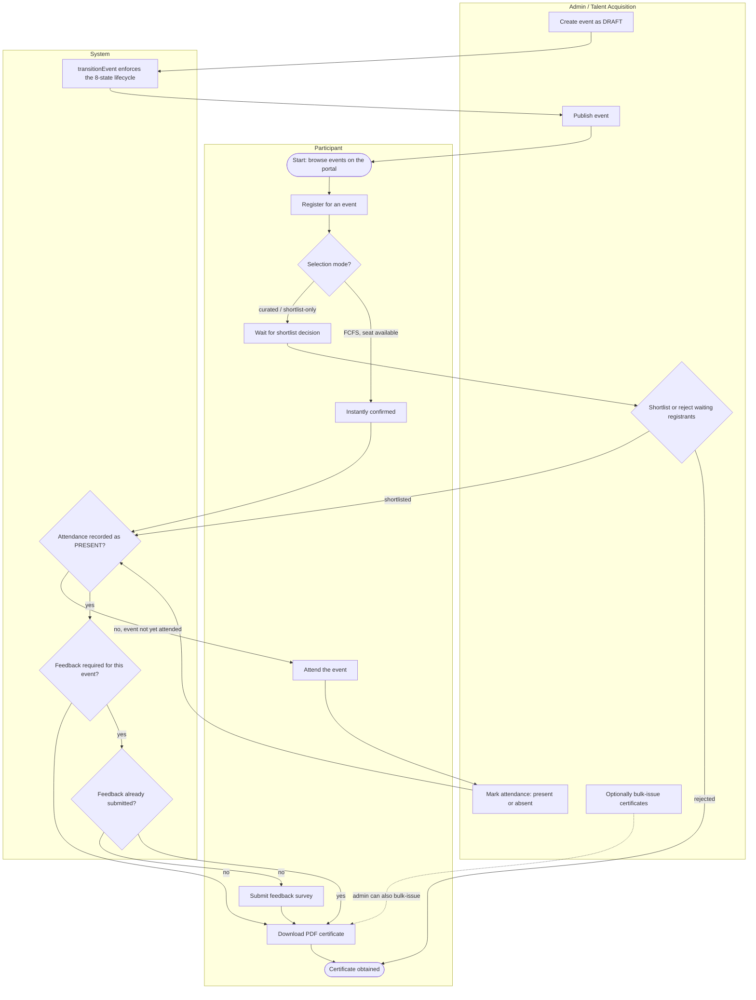

Evidence for each branch. **In `bliblitalk-user-fe`'s backend** (participant lane): registration
eligibility and the duplicate-active-registration guard; the shortlist-vs-instant-confirm decision at
`decideInitialStatus` (`showRemainingSeats===false` ⇒ every registrant starts `WAITING`, else FCFS
instant `REGISTERED` / `WAITING` (waitlist) / rejected-with-`EVENT_FULL`); feedback gated on
`attendance===PRESENT` + `event.enableFeedback`, one submission only; certificate download requiring
`attendance===PRESENT` and, when `enableFeedback` is on, feedback first (`FEEDBACK_REQUIRED` otherwise).
**In this repo** (admin + system lanes): shortlist/reject/waitlist gated by `PARTICIPANT_SHORTLIST`
(`apps/backend/src/routes/admin/adminParticipants.routes.ts`); attendance is **admin-only** — no
participant self-check-in endpoint exists in either backend; the eight-state lifecycle is enforced solely
by `transitionEvent` (`apps/backend/src/lib/lifecycle/transitionEvent.ts`); and admins can bulk-issue
certificates ahead of time (`adminCertificates.service.ts`), though the normal path is lazy generation on
the participant's first download.

---

## Architecture Diagrams

### A. Component / Deployment Diagram

**Component view**

No message queue/broker, no cloud storage SDK, and no third-party SaaS integration (payments, analytics,
error-tracking) exist anywhere in either repo — confirmed by exhaustive grep across both trees (see
External Connections below). The two frontends never talk to each other directly; both talk only to the
one backend.

The two apps no longer talk to each other over HTTP. Since the repo split their only coupling is the
**shared PostgreSQL database**, reached by two different roles with two different privilege sets — the
single most important structural fact on this diagram.

```mermaid
flowchart LR
    participant([Participant / external candidate])
    staff([Admin staff: Super Admin / Event Admin / Talent Acquisition])

    gateway["Apps Gateway - company SSO, authenticates at the edge"]

    subgraph userfe["bliblitalk-user-fe (separate repo)"]
      portal["Public Portal (React, Vite)"]
      pubapi["Public Backend (Express + Prisma)"]
    end

    subgraph adminrepo["bliblitalk-admin (this repo)"]
      adminfe["Admin CMS (React, Vite)"]
      backend["Admin Backend (Express + Prisma) - sole schema owner"]
    end

    db[("PostgreSQL 15 (citext extension)")]
    smtp["SMTP relay - external mail server"]
    disk[("Local disk - uploaded images")]

    participant -->|HTTPS| portal
    portal -->|"REST /api/* (JSON, own email-OTP session)"| pubapi
    staff -->|HTTPS| gateway
    gateway -->|"proxies, injects X-User-Id (email)"| adminfe
    adminfe -->|"REST /api/admin/*, /api/me (JSON, no cookie)"| backend

    backend -->|"Prisma, owner role: full read/write + DDL/migrations"| db
    pubapi -->|"Prisma, role bliblitalk_public: SELECT broadly, INSERT/UPDATE on 7 tables, no DELETE"| db

    backend -->|"SMTP send (marketing campaigns, event reminders)"| smtp
    pubapi -->|"SMTP send (login one-time codes)"| smtp
    backend -->|"multer disk storage"| disk
    disk -.->|"served unauthenticated at /api/uploads/* - read by BOTH frontends"| portal
```

Two things this diagram deliberately does not show as external nodes:

- **PDF certificate generation** (`pdfkit` / `svg-to-pdfkit`) is fully in-process — no network call and no
  external asset fetch on render (`apps/backend/src/routes/admin/adminCertificates.service.ts` and the
  shared certificate renderer; fonts and logo are bundled locally).
- **Schema mirroring** between the repos is a build-time file copy (`pnpm sync:admin`), not a runtime
  dependency. `schema.prisma`, `packages/shared-types` and `packages/auth` are authored here and mirrored
  byte-for-byte into `bliblitalk-user-fe`, where `pnpm check:schema-drift` fails CI on divergence. That is
  why the two backends can share one database without a shared service.

**Deployment & access boundary**

The repo split resolved the exposure question that the previous version of this document had to reason
around: the admin API and the public API are now **separate processes in separate repos**, so they can be
given different exposure levels without splitting one Express app. The owner's earlier target-state goal
("`/api/admin/*` and `/api/public/*` should eventually be split into separate Services with different
exposure") is therefore **met at the code level**; what remains is provisioning.

**The load-bearing deployment constraint — this app must be reachable only through Apps Gateway.**
Identity arrives as the `X-User-Id` header and the app deliberately does **not** re-validate or strip it
(`middleware/requireAuth.ts`, comment at the `USER_ID_HEADER` declaration): the gateway strips any
client-supplied value before setting its own, and at the app's edge the real header and a forged one are
indistinguishable. **Network isolation is the control.** Any ingress that reaches this backend without
passing through the gateway lets an anonymous caller assert any identity by sending one header. This is
not a hardening nicety; it is the authentication mechanism.

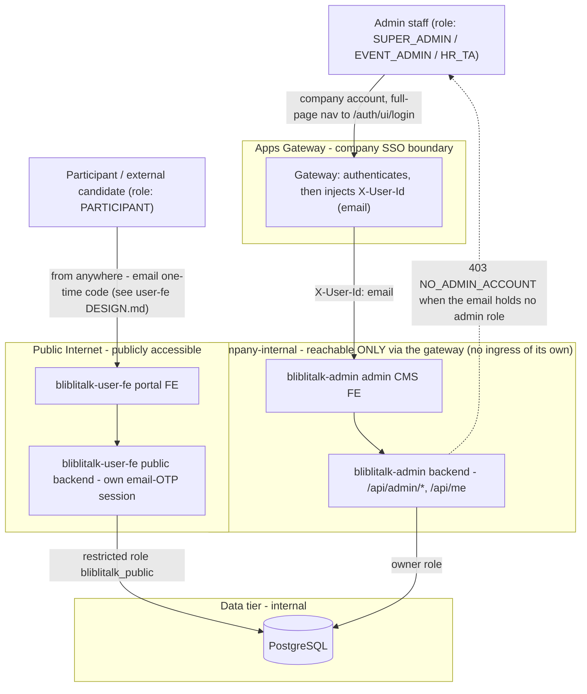

**What is provisioned today:** nothing. `k8s/README.md` remains a placeholder — no GKE cluster,
namespace, or Load Balancer exists, and the gateway registration itself is a DevOps action this project
never performs (`PROJECT.md` → Login Method records the subdomain / owners / `WHITELIST` access mode for
DevOps to apply). The **single-fullstack-container packaging** (Express serving the built admin FE on one
port, per the current `Dockerfile`) remains the intended shape. The owner's earlier confirmation that
"internal" means Blibli's corporate network/VPN rather than a strict VPC-only boundary still stands, and
is now reinforced by the gateway: the gateway is the boundary, and the app sits behind it.

> ⚠️ **`PROJECT.md` → Access Status is stale and contradicts this section.** It still describes the admin
> CMS as "gated behind Microsoft SSO" and the portal as using "Google OAuth", both of which were replaced
> (Apps Gateway here, email-OTP there). The *classification* it drives — High risk, because this repo owns
> the database the external-facing portal also reads — is unaffected and remains correct. Recommend
> refreshing that field via `project-documenter` before the next review; this document does not edit
> `PROJECT.md`.

### B. Sequence Diagrams & System Boundaries

No financial-asset, payment, or loyalty-point flow exists anywhere in this codebase (see Financial Risks
below for the exhaustive grep proof) — **no sequence diagram in this document uses the colored-`rect`
financial highlight**, since there is nothing to highlight.

> **Participant-facing flows moved out of this repo.** Browse/register, feedback submission and
> certificate download are served by `bliblitalk-user-fe`'s own backend and are documented in that repo's
> `docs/DESIGN.md`. They are not reproduced here — a design doc that diagrams another service's internals
> goes stale the moment that service changes, which is exactly how the previous version of this section
> became wrong. What this repo owns of those flows is the **data they read and write**, covered in the
> Database Schema and in the admin-side sequences below.

**Use case: Admin signs in (Apps Gateway; no credential ever reaches this app)**

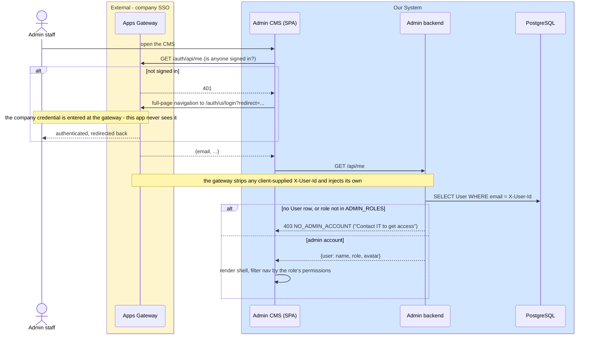

Three properties a reviewer should check against the code:

- **403, not 401, for a non-admin.** A 401 would bounce the browser back to the gateway, which would
  re-authenticate the same person and return them to the same wall — an infinite redirect
  (`requireAuth.ts`, comment above the `NO_ADMIN_ACCOUNT` throw). The 403 also preserves the
  population split: this backend never serves participants, a guarantee that used to live in the deleted
  login handler.
- **The gateway's own `admin` flag is ignored.** It describes gateway app-management rights, not this
  app's roles; authorization comes only from `packages/auth/src/rbac.ts` (`requirePermission` JSDoc).
- **The local-dev simulation compiles out.** `/dev-login` stores an email in `localStorage` and
  `authHeaders()` sends it as `X-User-Id`, guarded by `import.meta.env.DEV` alone — Vite folds that to
  `false`, so the code is *removed* from a production bundle rather than skipped at runtime
  (`apps/frontend/src/services/gatewayAuth.ts`; asserted by TEST-SCENARIO TS-026).

**Use case: Admin creates and publishes an event (single write path via transitionEvent)**

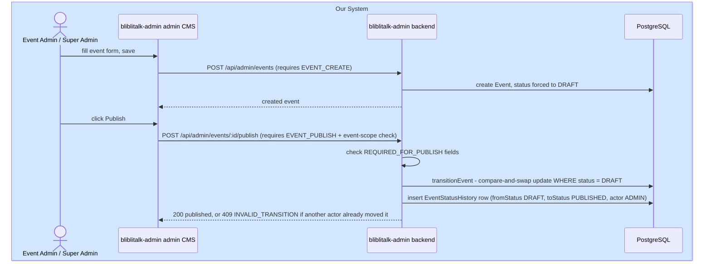

`transitionEvent` (`apps/backend/src/lib/lifecycle/transitionEvent.ts:24-89`) is documented in its own
comment as *"the ONLY code path allowed to mutate event.status"* — every admin lifecycle action
(publish/cancel/open-registration/close-registration/manual status override/generic transition) and the
scheduler below all funnel through it.

**Use case: Automated lifecycle scheduler (system-actor, no HTTP call)**

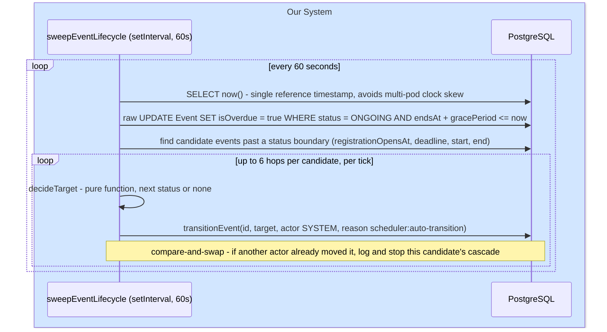

No pessimistic locking (`SELECT FOR UPDATE`, `SKIP LOCKED`, Postgres advisory locks) exists anywhere —
concurrency safety for multiple replicas comes entirely from `transitionEvent`'s own
`updateMany({where:{id,status:from}})` compare-and-swap
(`apps/backend/src/lib/lifecycle/sweepEventLifecycle.ts`, full file read; confirmed by repo-wide grep for
locking primitives returning zero code hits).

**Use case: Admin manages participants and attendance (role-based access difference)**

Event-scoping (`isEventScoped`, `packages/auth/src/rbac.ts`) applies **only** to `EVENT_ADMIN` —
`SUPER_ADMIN` and `HR_TA` see every event platform-wide, gated purely by the permission matrix. The
function's own comment states this is deliberate: *"HR_TA works across events and is scoped per feature by
the API instead."* ⚠️ **Still open (TEST-SCENARIO TS-020):** whether `HR_TA` being cross-event is the
intended org model. The `VIEWER` half of this question is moot — that role no longer exists.

**Use case: Admin bulk-issues certificates (this repo's half of the certificate story)**

The participant's own download path — and the `NOT_ATTENDED` / `FEEDBACK_REQUIRED` /
`CERTIFICATES_DISABLED` gate chain in front of it — lives in `bliblitalk-user-fe`'s backend and is
documented there. What this repo owns is the admin-initiated bulk issue, and the fact that **both paths
write the same `Certificate` table** and must agree on its uniqueness rule.

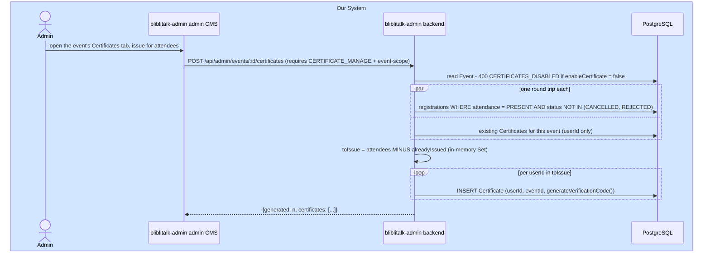

⚠️ **Finding for the reviewer — nothing in the database prevents a duplicate certificate.**
`generateCertificatesForEvent` (`apps/backend/src/routes/admin/adminCertificates.service.ts`) de-duplicates
by reading the event's existing certificates into an in-memory `Set` and skipping those `userId`s. That
check is **application-level and non-atomic**, and the `Certificate` model has a unique constraint on
`verificationCode` **only** — there is no `@@unique([userId, eventId])`. Two consequences:

- Two concurrent admin bulk-issues for the same event, or a bulk-issue racing the participant's own lazy
  first-download in the **other repo's backend**, can both pass the `Set` check and both insert. The
  attendee ends up with two valid certificates carrying different verification codes.
- The window is small and the impact is reputational rather than financial (there is no money in this
  system — see Financial Risks), which is presumably why it has not bitten. But it is a real gap, it
  spans two repos that no single test exercises together, and the fix is cheap: a
  `@@unique([userId, eventId])` on `Certificate` plus catching the resulting `P2002` as "already issued".

This is recorded here rather than silently fixed because it is a schema change with a migration, outside
the scope of regenerating a design document.

**Use case: Marketing email campaign (real SMTP integration)**

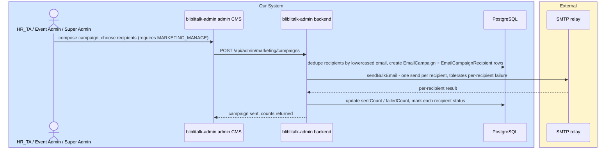

Throws `EMAIL_NOT_CONFIGURED_MESSAGE` if `SMTP_HOST` is unset (`apps/backend/src/lib/shared/mailer.ts:5-6,33`)
— the local `docker-compose.yml` sets no SMTP env vars, so email is unconfigured in that stack today.

**Use case: Event reminders — scheduled two-audience send**

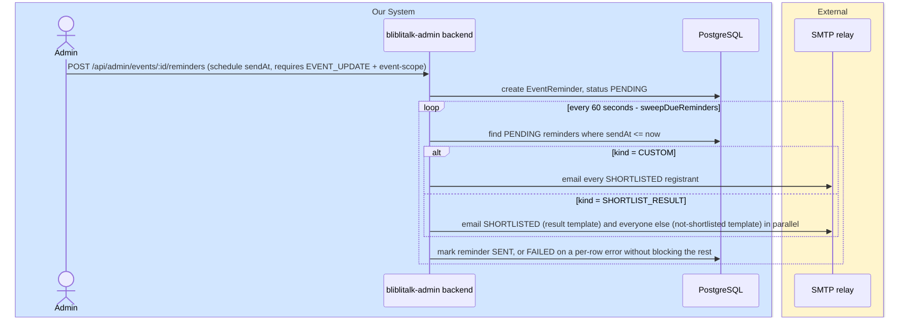

### C. Transaction / Data-Flow (no queue/broker; the closest analogue is the Event status write path)

No message queue, event stream, or broker exists anywhere in either repo (`bull|bullmq|kafka|rabbitmq|
redis|amqp` grepped across both trees, zero real hits). There is no financial transaction to track (see
Financial Risks). The closest thing to a "transaction ownership" story in this codebase is the
compare-and-swap write to `Event.status`, which the scheduler and every admin lifecycle action share as
their single write path:

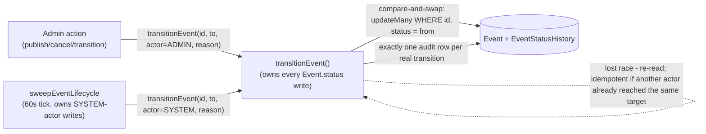

- **Transaction ownership:** `transitionEvent()` alone (`apps/backend/src/lib/lifecycle/transitionEvent.ts:24-89`)
  — CONFIRMED, its own comment states it is "the ONLY code path allowed to mutate event.status."
- **Upstream systems with access:** none — only this backend process ever writes `Event.status`; no other
  service or job touches this table.
- **Failure & recovery:** the compare-and-swap (`updateMany` guarded on current `status`) means a losing
  writer simply re-reads and either finds the target already reached (idempotent no-op) or gets a fresh
  409 reflecting the real current status — CONFIRMED, `transitionEvent.ts:50-84`. `COMPLETED` side-effects
  (clearing `isOverdue`, flipping `displayConfig.pastEvent`) run **after** commit and are never rolled back
  on failure — instead recorded as `sideEffectsStatus=FAILED` on the history row for manual follow-up
  (`transitionEvent.ts:86-113`). ⚠️ Whether a `FAILED` side-effect has ever needed manual remediation in
  practice is an owner/ops question, not something the code shows.

---

## Database Schema

Single Postgres 15 database, owned exclusively by `bliblitalk-admin`'s backend — `bliblitalk-user-fe` has
no database access of any kind (confirmed: no Prisma schema, no `DATABASE_URL` anywhere in that repo).
17 models, all in `apps/backend/src/db/prisma/schema.prisma`, plus 2 Prisma-implicit many-to-many join
tables.

```mermaid
erDiagram
    USER ||--o{ REGISTRATION : "registers"
    USER ||--o{ CERTIFICATE : "owns"
    USER ||--o{ FEEDBACK : "submits"
    USER |o--o{ OTPCHALLENGE : "requests login codes (ON DELETE CASCADE; null owner = registration code)"
    USER }o--o{ EVENT : "administers (EventAdmins)"
    USER ||--o{ EVENT : "owns (EventOwner, nullable)"
    EVENTCATEGORY ||--o{ EVENT : "categorizes"
    EVENT }o--o{ SPEAKER : "features (EventSpeakers)"
    EVENT ||--o{ REGISTRATION : "has"
    EVENT ||--o{ CERTIFICATE : "issues"
    EVENT ||--o{ FEEDBACK : "collects"
    EVENT ||--o{ EVENTREMINDER : "schedules"
    EVENT ||--o{ EVENTSTATUSHISTORY : "logs"
    REGISTRATION ||--o| SPEEDDATINGREGISTRATION : "opts into"
    REGISTRATION ||--o| FEEDBACK : "yields"
    EMAILCAMPAIGN ||--o{ EMAILCAMPAIGNRECIPIENT : "sends to"

    USER {
        string id PK
        string email UK
        string role "SUPER_ADMIN | EVENT_ADMIN | HR_TA | PARTICIPANT"
        string employmentType "INTERNAL | EXTERNAL"
    }
    OTPCHALLENGE {
        string id PK
        string userId FK "nullable - ON DELETE CASCADE; null while a registration code is outstanding"
        string codeHash "bcrypt - plaintext code is never stored"
        datetime expiresAt "createdAt + 15 min"
        int attempts "locks at 5"
        datetime consumedAt "nullable - consumption is an UPDATE, never a DELETE"
    }
    EVENTCATEGORY {
        string id PK
        string name UK "citext - case-insensitive unique"
        bool isActive
    }
    EVENT {
        string id PK
        string slug UK
        string categoryId FK
        string ownerId FK "nullable, ON DELETE SET NULL"
        string status "8-state lifecycle enum"
        string selectionMode "FCFS | CURATED"
    }
    SPEAKER {
        string id PK
        string name
    }
    REGISTRATION {
        string id PK
        string userId FK
        string eventId FK
        string status "REGISTERED|WAITING|REJECTED|SHORTLISTED|CANCELLED"
        string attendance "PRESENT|ABSENT|PENDING"
    }
    SPEEDDATINGREGISTRATION {
        string id PK
        string registrationId FK "unique - enforces 1:1"
    }
    CERTIFICATE {
        string id PK
        string userId FK
        string eventId FK
        string verificationCode UK
    }
    FEEDBACK {
        string id PK
        string registrationId FK "unique - enforces 1:1"
        string userId FK
        string eventId FK
        int overallRating
        int npsScore
    }
    ANNOUNCEMENT {
        string id PK
        string title
    }
    SITESETTINGS {
        string id PK "fixed default: singleton"
        string contactEmail
    }
    MODULESETTINGS {
        string key PK
        json data
    }
    MARKETINGCONTACT {
        string id PK
        string email UK
    }
    EMAILCAMPAIGN {
        string id PK
        string subject
    }
    EMAILCAMPAIGNRECIPIENT {
        string id PK
        string campaignId FK
        string email
    }
    EVENTREMINDER {
        string id PK
        string eventId FK
        string kind "CUSTOM | SHORTLIST_RESULT"
    }
    EVENTSTATUSHISTORY {
        string id PK
        string eventId FK "ON DELETE CASCADE - the one exception to RESTRICT"
        string fromStatus "nullable"
        string toStatus
        string actorType "ADMIN | SYSTEM"
    }
```

**Table: `User`** (`schema.prisma:58-88`)

| Field | Type | Nullable | Key | Description |
|---|---|---|---|---|
| id | String (cuid) | no | PK | |
| email | String | no | UNIQUE | login identity |
| name | String | no | — | |
| role | Role enum | no, default PARTICIPANT | — | `SUPER_ADMIN\|EVENT_ADMIN\|HR_TA\|PARTICIPANT`; `HR_TA` is labeled "Talent Acquisition" in the admin UI. `VIEWER` was dropped from the enum on 2026-08-06 |
| employmentType | EmploymentType enum | no, default EXTERNAL | — | `INTERNAL\|EXTERNAL` |
| department | String | yes | — | |
| position | String | yes | — | |
| phone | String | yes | — | |
| avatarUrl | String | yes | — | |
| institution | String | yes | — | self-registration field, external participants (company/school/org) |
| yearsOfExperience | String | yes | — | self-registration field |
| passwordHash | String | **yes** | — | Legacy column, unwritten since 2026-08-06. Participants have always signed in by emailed one-time code, and staff accounts stopped storing a password when this app moved behind Apps Gateway. Kept nullable rather than dropped so pre-existing rows are not rewritten by a migration; nothing reads it |
| createdAt | DateTime | no, default now() | — | doubles as the registration/consent timestamp for participant self-registration (GRC audit) |

**Table: `OtpChallenge`** (`schema.prisma:97-117`)

Email one-time-code login for participants (`bliblitalk-user-fe`, 2026-08). Its own table rather
than columns on `User`, so each request is independently auditable and concurrent requests from
multiple tabs/devices cannot clobber one shared row.

A row with a null `userId` is a **registration** challenge: the account does not exist yet, and
nothing identifying the applicant is stored — not even the address the code was sent to. The
profile they typed rides in a short-lived signed token held by their browser, and the `User` row
is created only when the code comes back, so `User.createdAt` records a completed registration
rather than an abandoned attempt.

| Field | Type | Nullable | Key | Description |
|---|---|---|---|---|
| id | String (cuid) | no | PK | |
| userId | String | **yes** | FK → `User`, ON DELETE CASCADE | set for sign-in codes; null for registration codes, where no account exists yet |
| codeHash | String | no | — | bcrypt hash of the 6-digit code; the plaintext is never stored, only emailed |
| expiresAt | DateTime | no | — | `createdAt` + 15 minutes |
| attempts | Int | no, default 0 | — | wrong-code count; the challenge locks at 5 |
| consumedAt | DateTime | yes | — | set on successful verify, on lockout, and when superseded by a newer request. Consumption is an UPDATE, never a DELETE — the restricted `bliblitalk_public` role has no DELETE grant anywhere, by design |
| createdAt | DateTime | no, default now() | — | |

**Table: `Speaker`** (`schema.prisma:119-130`)

| Field | Type | Nullable | Key | Description |
|---|---|---|---|---|
| id | String (cuid) | no | PK | |
| name | String | no | — | |
| title | String | yes | — | |
| company | String | yes | — | |
| bioShort | String | yes | — | |
| bioLong | String | yes | — | |
| credentials | String[] | no, default [] | — | |
| avatarUrl | String | yes | — | |
| featured | Boolean | no, default false | — | |

**Table: `EventCategory`** (`schema.prisma:132-138`, added migration `20260718060000_category_taxonomy`)

| Field | Type | Nullable | Key | Description |
|---|---|---|---|---|
| id | String (cuid) | no | PK | |
| name | String @db.Citext | no | UNIQUE (case-insensitive) | requires the Postgres `citext` extension |
| isActive | Boolean | no, default true | — | soft-delete flag; never physically deleted |
| createdAt | DateTime | no, default now() | — | |

**Table: `Event`** (`schema.prisma:140-207`) — the largest table

| Field | Type | Nullable | Key | Description |
|---|---|---|---|---|
| id | String (cuid) | no | PK | |
| slug | String | no | UNIQUE | |
| eventCode | String | yes | — | |
| title | String | no | — | |
| subtitle | String | yes | — | |
| bannerUrl | String | yes | — | Wide hero strip (~1600×400): event detail hero, landing spotlight, admin workspace header. One of three per-shape image fields — see the note below the table |
| thumbnailUrl | String | yes | — | Landscape card (~800×500): every list/card/row surface in both apps |
| posterUrl | String | yes | — | Portrait poster (~640×960): the tall poster column of a My Events row. Added 2026-08-11 (`migrations/20260811100000_event_poster_url`) |
| description | String | no | — | |
| categoryId | String | no | FK → EventCategory | ON DELETE RESTRICT |
| tags | String[] | no, default [] | — | |
| location | String | no | — | |
| startsAt | DateTime | no | — | |
| endsAt | DateTime | no | — | |
| capacity | Int | no, default 0 | — | 0 = unlimited |
| status | EventStatus enum | no, default DRAFT | — | 8-state lifecycle; **only** `transitionEvent()` may write this |
| statusChangedAt | DateTime | no, default now() | — | |
| isOverdue | Boolean | no, default false | — | set by the scheduler when `ONGOING` + past `endsAt + gracePeriodMinutes` |
| gracePeriodMinutes | Int | no, default 120 | — | |
| autoCompleteAfterMinutes | Int | no, default 2880 | — | |
| selectionMode | SelectionMode enum | no, default FCFS | — | `FCFS\|CURATED`; backfilled historically from `showRemainingSeats` (⚠️ heuristic, not a verified historical record) |
| hasSpeedDating | Boolean | no, default false | — | |
| featured | Boolean | no, default false | — | |
| recommended | Boolean | no, default false | — | |
| ownerId | String | yes | FK → User | ON DELETE SET NULL |
| showRemainingSeats | Boolean | no, default true | — | `false` ⇒ "shortlist-only" UX + backfilled `selectionMode=CURATED` |
| enableCertificate | Boolean | no, default true | — | |
| enableFeedback | Boolean | no, default false | — | |
| waitingListEnabled | Boolean | no, default true | — | |
| registrationOpensAt | DateTime | yes | — | |
| publishedAt | DateTime | yes | — | |
| venue | String | yes | — | |
| mapsUrl | String | yes | — | |
| registrationDeadline | DateTime | yes | — | |
| eventType | String | yes | — | |
| dressCode | String | yes | — | |
| language | String | yes | — | |
| organizedBy | String | yes | — | |
| importantNotes | String | yes | — | |
| learningPoints | Json | no, default [] | — | |
| discussionPoints | Json | no, default [] | — | |
| agenda | Json | no, default [] | — | |
| faqs | Json | no, default [] | — | |
| galleryImages | String[] | no, default [] | — | |
| recordingUrl | String | yes | — | |
| presentationUrl | String | yes | — | |
| displayConfig | Json | no, default (object) | — | per-event display toggles |

Indexes: `@@index([status, registrationOpensAt])`, `@@index([status, registrationDeadline])`,
`@@index([status, startsAt])`, `@@index([status, endsAt])` — added specifically to serve the scheduler's
candidate-fetch queries (migration `20260716105058_lifecycle_scheduler_indexes`).

**The three image fields are one per rendered shape, not one image reused everywhere.** An admin uploads
whichever they care about; each is optional, and the *consumer* resolves a fallback chain rather than the
database storing a default. The portal's resolver (`bliblitalk-user-fe/apps/frontend/src/utils/eventImage.ts`)
is the single place that decides:

| Slot shape | Fallback chain | Why |
|---|---|---|
| `poster` (2:3) | `posterUrl → thumbnailUrl → bannerUrl` | A wider image cropped to portrait still reads as a photo |
| `card` (16:10) | `thumbnailUrl → bannerUrl` | Same reasoning, one step shorter |
| `wide` (~4:1) | `bannerUrl` **only — no fallback** | A portrait or card image cropped to a 4:1 strip reads as a broken image. A branded gradient placeholder is the better failure |

This repo's responsibility is only to store the three fields and return them distinctly — asserted end to
end by TEST-SCENARIO **TS-028** (`adminEvents.routes.test.ts` for the write path, `mappers.test.ts` for
`toEventDTO`). ⚠️ Note the cross-repo seam: the fallback *policy* lives in the other repo, and no test
exercises the storage and the policy together.

**Table: `Registration`** (`schema.prisma:209-226`)

| Field | Type | Nullable | Key | Description |
|---|---|---|---|---|
| id | String (cuid) | no | PK | |
| userId | String | no | FK → User | ON DELETE RESTRICT |
| eventId | String | no | FK → Event | ON DELETE RESTRICT |
| status | RegistrationStatus enum | no, default REGISTERED | — | `REGISTERED\|WAITING\|REJECTED\|SHORTLISTED\|CANCELLED` |
| attendance | Attendance enum | no, default PENDING | — | `PRESENT\|ABSENT\|PENDING`, admin-set only |
| shortlistedAt | DateTime | yes | — | |
| checkedInAt | DateTime | yes | — | |
| cancelledAt | DateTime | yes | — | |
| createdAt | DateTime | no, default now() | — | |

Constraint: `@@unique([userId, eventId])` — one registration per user per event (a cancelled one may be
re-created; `REJECTED` is terminal).

**Table: `SpeedDatingRegistration`** (`schema.prisma:228-234`)

| Field | Type | Nullable | Key | Description |
|---|---|---|---|---|
| id | String (cuid) | no | PK | |
| registrationId | String | no | FK+UNIQUE → Registration | enforces 1:1; ON DELETE RESTRICT |
| sessionInfo | String | yes | — | |
| status | String | no, default "PENDING" | — | plain string, not a DB enum |

**Table: `Announcement`** (`schema.prisma:236-242`)

| Field | Type | Nullable | Key | Description |
|---|---|---|---|---|
| id | String (cuid) | no | PK | |
| title | String | no | — | |
| body | String | no | — | |
| publishedAt | DateTime | no, default now() | — | |
| pinned | Boolean | no, default false | — | |

**Table: `Certificate`** (`schema.prisma:244-252`)

| Field | Type | Nullable | Key | Description |
|---|---|---|---|---|
| id | String (cuid) | no | PK | |
| userId | String | no | FK → User | ON DELETE RESTRICT |
| eventId | String | no | FK → Event | ON DELETE RESTRICT |
| issuedAt | DateTime | no, default now() | — | |
| verificationCode | String | no | UNIQUE | |

**Owner-confirmed:** the absence of a unique constraint on `(userId, eventId)` is **intentional** —
re-issuance (a participant legitimately holding more than one certificate row for the same event, each
with its own `verificationCode`) is a real, supported scenario, not an oversight.

**Table: `Feedback`** (`schema.prisma:257-279`)

| Field | Type | Nullable | Key | Description |
|---|---|---|---|---|
| id | String (cuid) | no | PK | |
| registrationId | String | no | FK+UNIQUE → Registration | enforces 1:1 |
| userId | String | no | FK → User | |
| eventId | String | no | FK → Event | |
| overallRating | Int | no | — | comment claims 1–10; ⚠️ **not enforced by any DB CHECK constraint** |
| topicRating | Int | no | — | same caveat |
| qnaRating | Int | no | — | same caveat |
| contentRating | Int | no | — | same caveat |
| speakerRating | Int | no | — | same caveat |
| venueRating | Int | no | — | same caveat |
| timingRating | Int | no | — | same caveat |
| npsScore | Int | no | — | comment claims 0–10; same caveat |
| takeaway | String | yes | — | |
| topicsWanted | String | yes | — | |
| speakerWanted | String | yes | — | |
| comments | String | yes | — | |
| createdAt | DateTime | no, default now() | — | |

**Table: `SiteSettings`** (`schema.prisma:282-285`) — singleton row

| Field | Type | Nullable | Key | Description |
|---|---|---|---|---|
| id | String | no, default "singleton" | PK | singleton pattern by convention only, not DB-enforced |
| contactEmail | String | no, default "recruitment@blibli.com" | — | |

**Table: `ModuleSettings`** (`schema.prisma:290-294`) — generic per-module JSON config store

| Field | Type | Nullable | Key | Description |
|---|---|---|---|---|
| key | String | no | PK | convention keys: `speed_dating`, `feedback`, `certificate`, `login_carousel_admin`, `login_carousel_portal` |
| data | Json | no | — | |
| updatedAt | DateTime | no, @updatedAt | — | |

**Table: `MarketingContact`** (`schema.prisma:298-304`)

| Field | Type | Nullable | Key | Description |
|---|---|---|---|---|
| id | String (cuid) | no | PK | |
| email | String | no | UNIQUE | |
| name | String | yes | — | |
| source | String | no, default "manual" | — | `"manual"\|"registrant"` per comment, not DB-enforced |
| createdAt | DateTime | no, default now() | — | |

⚠️ No FK relation to `User`/`Registration` despite a schema comment describing this as synced from past
registrants — confirm whether this decoupling is intentional (contacts can outlive/predate a `User` row).

**Table: `EmailCampaign`** (`schema.prisma:306-316`)

| Field | Type | Nullable | Key | Description |
|---|---|---|---|---|
| id | String (cuid) | no | PK | |
| subject | String | no | — | |
| bodyHtml | String | no | — | |
| createdAt | DateTime | no, default now() | — | |
| sentAt | DateTime | yes | — | |
| recipientCount | Int | no, default 0 | — | |
| sentCount | Int | no, default 0 | — | |
| failedCount | Int | no, default 0 | — | |

**Table: `EmailCampaignRecipient`** (`schema.prisma:318-326`)

| Field | Type | Nullable | Key | Description |
|---|---|---|---|---|
| id | String (cuid) | no | PK | |
| campaignId | String | no | FK → EmailCampaign | ON DELETE RESTRICT |
| email | String | no | — | |
| name | String | yes | — | |
| status | String | no, default "PENDING" | — | `PENDING\|SENT\|FAILED`, plain string |
| error | String | yes | — | |

**Table: `EventReminder`** (`schema.prisma:335-351`)

| Field | Type | Nullable | Key | Description |
|---|---|---|---|---|
| id | String (cuid) | no | PK | |
| eventId | String | no | FK → Event | ON DELETE RESTRICT |
| kind | ReminderKind enum | no, default CUSTOM | — | `CUSTOM\|SHORTLIST_RESULT` |
| sendAt | DateTime | no | — | must be future at creation |
| subject | String | no | — | shortlisted-audience template |
| bodyHtml | String | no | — | shortlisted-audience template |
| subjectNotShortlisted | String | yes | — | non-shortlisted-audience template (SHORTLIST_RESULT kind only) |
| bodyHtmlNotShortlisted | String | yes | — | non-shortlisted-audience template |
| status | String | no, default "PENDING" | — | `PENDING\|SENT\|FAILED`, plain string |
| sentAt | DateTime | yes | — | |
| recipientCount | Int | no, default 0 | — | |
| sentCount | Int | no, default 0 | — | |
| failedCount | Int | no, default 0 | — | |
| createdAt | DateTime | no, default now() | — | |

**Table: `EventStatusHistory`** (`schema.prisma:353-366`) — the lifecycle audit trail, added migration
`20260716060555_lifecycle_engine`

| Field | Type | Nullable | Key | Description |
|---|---|---|---|---|
| id | String (cuid) | no | PK | |
| eventId | String | no | FK → Event | **ON DELETE CASCADE** — the one exception to RESTRICT everywhere else |
| fromStatus | EventStatus enum | yes | — | null on the very first row |
| toStatus | EventStatus enum | no | — | |
| actorType | String | no | — | `"ADMIN"\|"SYSTEM"`, plain string |
| actorId | String | yes | — | `User.id` when actorType=ADMIN, else null; no declared FK constraint |
| reason | String | yes | — | |
| sideEffectsStatus | String | no, default "PENDING" | — | `PENDING\|DONE\|FAILED\|NONE` |
| createdAt | DateTime | no, default now() | — | |

**Implicit many-to-many join tables** (Prisma-managed, both `ON DELETE CASCADE ON UPDATE CASCADE`):
`_EventSpeakers` (Event.id ↔ Speaker.id), `_EventAdmins` (Event.id ↔ User.id, added alongside the
RBAC migration).

**No CHECK constraints exist in any migration** — every `PENDING|SENT|FAILED`-style status field
(`EmailCampaignRecipient.status`, `EventReminder.status`, `EventStatusHistory.sideEffectsStatus`,
`SpeedDatingRegistration.status`) is a plain unconstrained TEXT column, validated (if at all) only in
application code.

**Schema-evolution note (owner-confirmed):** migration `20260716060555_lifecycle_engine`'s comment says
*"no data remap here — P7 handles that"* for the `EventStatus` 5→8 value expansion, and no migration
performs that remap. This is moot in the current state: **there is no legacy production data with old
5-state values to remap** — the system is greenfield/seed-only today. The P7 backfill/reconciliation
task only becomes relevant if real legacy-status data exists at the time P7 runs.

---

## External Connections & Integrations

This repo has exactly **one real outbound-network integration** (SMTP email), one identity boundary it
consumes rather than calls (Apps Gateway), one fully in-process capability (PDF generation — explicitly
**not** external), and one local-disk capability (file uploads — explicitly **not** cloud storage). No
queue/broker, no cloud-storage SDK, no third-party SaaS SDK (payments, analytics, error-tracking) exists
anywhere — confirmed by exhaustive grep across both repos.

The row that used to describe the portal calling this backend is **gone**: since the repo split the portal
has its own backend, and the two apps meet at the database, not over HTTP. The mocked Microsoft/Google
"SSO" row is **gone** too — that code was deleted, not replaced in place.

| Integration | Direction | What (data) | Why (purpose) | Where (host/endpoint/zone) | When (trigger/frequency) | How (protocol + auth) |
|---|---|---|---|---|---|---|
| Apps Gateway | inbound (the gateway calls us; we never call it server-side) | The signed-in user's email in `X-User-Id`; the browser separately reads `GET /auth/api/me` | Company SSO — this app's entire authentication | Gateway subdomain in front of this app; registration is a DevOps action (see `PROJECT.md` → Login Method) | Every request to every non-probe path | HTTP header injection. The gateway strips any client-supplied `X-User-Id` first; **the app does not re-validate it, so network isolation is the control** |
| SMTP relay | outbound | Recipient email/name, campaign or reminder HTML body | Marketing email campaigns; event reminders (custom + shortlist-result) | `SMTP_HOST`/`PORT` env vars — **owner-confirmed**: owned by Blibli's IT/infra team and already provisioned (real credentials injected at deploy time, never checked into either repo) | Campaign: admin-initiated, synchronous, one-shot. Reminders: 60s scheduler tick, sends any `PENDING` row past its `sendAt` | SMTP (port from env; TLS if port 465), optional username/password auth |
| Shared PostgreSQL ← `bliblitalk-user-fe` backend | inbound (another service reads/writes the database this repo owns) | Events, registrations, feedback, certificates, OTP challenges | The portal's backend serves participants from the same data this CMS administers | Same database instance; separate Postgres role `bliblitalk_public` | Continuously, on portal traffic | Postgres protocol. **Least privilege enforced in the database, not in application code**: SELECT broadly, INSERT/UPDATE on seven participant-owned tables, **no DELETE anywhere** (`scripts/db/provision-public-role.sql`) |
| Google Calendar deep link | outbound (browser navigation only, no data leaves either server) | Event title/time/location as URL params | "Add to Google Calendar" convenience link | `calendar.google.com/calendar/render` | User click on the event detail page | Plain URL, no API key, no OAuth |
| Local disk uploads | n/a (not external) | Event banner/thumbnail/poster and speaker avatar images | Admin-uploaded assets | `apps/backend/uploads/` on the backend's own filesystem | `POST /api/admin/uploads` | multipart/form-data; served back **unauthenticated** at `/api/uploads/*`, read by **both** frontends |

Cross-reference: no `docs/DEPENDENCIES.md` exists yet in either repo — recommend generating one (e.g. via
`project-documenter`) to carry the full npm-package vendor inventory; this table covers only genuine
network/boundary crossings, not every library dependency.

**⚠️ Known blocker on the gateway rollout — the uploads path.** Behind Apps Gateway every non-probe path
is login-required, so an anonymous portal visitor fetching `` would be
redirected to the gateway's login UI and the images would break. The fix is **Phase 6 (uploads → Google
Cloud Storage)**, which is deferred; widening the gateway's public path prefix to paper over it is
explicitly rejected in the code comment at `app.ts` and in `PROJECT.md` → Login Method. Until Phase 6
lands, an admin-uploaded image renders in the CMS but **not** on a deployed public portal. This is the
single largest open item in this document.

**Owner-confirmed decisions on the boundary crossings above:** the SMTP relay is owned by Blibli's
IT/infra team and already provisioned. The mocked Google/Microsoft sign-in was to be *"replaced with real
OAuth/OIDC before any production/go-live"* — **that commitment is now met** for this repo, by Apps Gateway
rather than a direct IdP integration. ⚠️ **Still open:** durability of the upload store (today: local
ephemeral disk on the backend container — not persisted across restarts, not backed by object storage; a
real risk once the container is redeployed or scaled past one replica), which Phase 6 also resolves.

---

## Financial Risks & Mitigation

Ran an exhaustive, explicit (not assumed) case-insensitive grep for `payment|money|wallet|ledger|balance|
loyalty|points|refund|transfer|amount|currency` across every `.ts/.tsx/.json/.prisma/.sql/.md` file in
both repos. Result: **zero hits** in actual source code for `payment, money, wallet, ledger, balance,
loyalty, refund, transfer, amount, currency`. The only documentation-only hit was
`bliblitalk-admin/TECH_STACK.md:13`, which explicitly states the backend does **not** call external
payment APIs today and lists "payment" only as a *hypothetical future trigger* for reclassifying the
project's risk zone if one were ever added. All 16 Prisma models were reviewed (Database Schema, above) —
none is financial/transactional in nature.

**N/A — no financial assets or transactions detected in code (confirmed with exhaustive grep, not
assumed). Race Conditions, Failure Models, and Duplicate Transaction Detection therefore do not apply to
this project as a financial-risk category** — the closest analogue (the `Event.status` compare-and-swap
write path) is documented instead under Architecture Diagrams §C above, since it is a data-integrity
concern, not a financial one.

### API Security

There is no `docs/SECURITY.md` in either repo yet (confirmed by filename search) to cross-reference, so
this summary carries the seed findings directly — **recommend authoring `docs/SECURITY.md`** (e.g. via a
dedicated OWASP-style review) using the detail below as its starting material.

- **Authentication:** **none in this app, by design.** Apps Gateway (the approved company SSO)
  authenticates at the edge and forwards the user's email as `X-User-Id`. There is no login endpoint, no
  session, no cookie, no JWT and no stored password anywhere in this repo — the previous mocked-SSO and
  bcrypt-password code was **deleted**, and with it the finding that "anyone who can reach
  `POST /api/auth/microsoft` and guesses an admin's email obtains a full admin session." `requireAuth`
  (`apps/backend/src/middleware/requireAuth.ts`) maps the header to a `User` row and returns **403
  `NO_ADMIN_ACCOUNT`** if the address holds no admin role.
  - **The security of this rests entirely on network isolation.** The app deliberately does not
    re-validate or strip `X-User-Id`, because at its edge a gateway-set header and a client-set one are
    indistinguishable — stripping would discard the real one too. If this backend is ever reachable
    without traversing the gateway, **any anonymous caller can become any admin by sending one header.**
    A reviewer should treat "no ingress of its own" as a security control, not a deployment preference.
  - The gateway's own `admin` flag is never reused as a role; authorization stays with `@repo/auth`.
  - The DEV-only gateway simulation (`/dev-login` + `authHeaders()`) is compiled out of production builds
    by `import.meta.env.DEV`, verified by TEST-SCENARIO **TS-026** against the built bundle.
- **Authorization model:** RBAC via a single shared `packages/auth/src/rbac.ts` — **4 roles** (3 of them
  admin) and 15 permissions, consumed identically by backend middleware and the admin frontend's nav
  filtering, so the client and server cannot drift. Every `/api/admin/**` route (except the dashboard,
  which uses a coarse role-allowlist) is gated by a specific `Permission`; `EVENT_ADMIN` is additionally
  scoped to its own assigned events. Frontend nav-hiding is UX-only — `requirePermission` /
  `requireEventAccess` on the server is the authoritative boundary.
  - **Regression a reviewer should note from the `VIEWER` removal:** `VIEWER` was the only Admin CMS role
    lacking `USER_MANAGE`, so `GET /api/admin/users` is no longer deniable to any admin tier. The
    narrowest remaining permission boundary is `ROLE_MANAGE` (`SUPER_ADMIN` only), and the denial tests
    were re-pointed at it — a narrower boundary than before, not a weaker one.
- **Encryption & sensitive data:** no session token exists to protect, so the entire JWT-secret finding
  from the previous version — the hardcoded `"dev-only-change-me"` fallback, the checked-in dev `.env`
  using it, the absent revocation list, the 7-day validity window — **no longer applies to this repo.**
  `JWT_SECRET` and `COOKIE_NAME` are gone from `config.ts`. Cookies are not read at all: there is no
  `cookie-parser`. What remains sensitive here is participant PII in the database (names, emails,
  institution, years of experience) and the SMTP credentials, both injected as env vars.
  - Log redaction is retained deliberately even though this app issues no session: `LOG_REDACT_PATHS`
    still strips `req.headers.cookie`, `authorization` and `set-cookie`, because the *gateway's* cookie
    rides along on every request (`app.ts`).
- **Controls present today:** an admin API rate limiter (`createAdminApiRateLimiter`, 15-minute window)
  mounted across `/api/admin`; `trust proxy = 1` set to match the documented single-proxy topology so
  per-client buckets don't collapse into one; upload validation with a **5 MB** size cap and a MIME
  allowlist (PNG/JPG/WEBP/GIF, 415 otherwise); per-prefix CORS mounts (`/api/me`, `/api/admin`), never a
  wildcard, `credentials` removed along with the cookie.
- **Controls still absent:** no `helmet` / security-headers middleware — no CSP, no `X-Frame-Options`
  (confirmed: `helmet` is not a dependency). CSRF is now largely moot for this app — with no cookie-based
  session, a cross-site request carries no ambient credential, and the gateway's own cookie is not what
  authorizes the call; `X-User-Id` is, and a browser cannot set it cross-origin. The uploads path
  (`/api/uploads/*`) is served unauthenticated by design and is the one surface that is not behind a
  permission check.
- **Risk acceptance (owner-confirmed, re-scoped this pass):** the earlier acceptance covered "missing
  rate-limiting, missing CSRF token, and the hardcoded fallback JWT secret" on the basis of an
  internal-network deployment. Two of those three are **resolved rather than accepted** (a rate limiter
  now exists; the JWT secret is gone with the sessions). What remains accepted is the absence of security
  headers, and the unauthenticated uploads path — the latter only until Phase 6. The acceptance remains
  **scoped to the internal-network model** and must be revisited if exposure changes. It is recorded in
  `PROJECT.md` Review Evidence, not only here.
- **Compliance:** ⚠️ owner input — no compliance requirements are stated anywhere in either repo.

---

## Review Checklist

### Architecture
- [x] Product overview provided
- [x] Objectives / goals stated (owner-confirmed: employee career development + recruiting/employer branding; no numeric KPI set yet)
- [x] Business workflow diagram included
- [x] Component diagram included
- [x] Deployment diagram included (access/trust boundary: who, from where, network-only vs public, login) — now shows the Apps Gateway boundary and the gateway-only-reachability constraint; still no real infra provisioned (documented, not fabricated)
- [x] Sequence diagrams included for major use cases — participant-facing flows deliberately delegated to `bliblitalk-user-fe`'s own DESIGN.md rather than duplicated
- [x] System boundaries clearly defined — including the shared-database boundary between the two repos and the two Postgres roles
- [x] Role-based access differences shown where they exist
- [x] All Mermaid diagrams parse locally — **12/12** blocks pass. Method: local headless `mermaid` 11.16.1 + `jsdom` 30.0.1, `mermaid.parse()` per block (`mmdc` was not on PATH; the static-lint fallback was not needed, and nothing was sent to a hosted renderer). One block failed on the first run — an unquoted `;` in sequence text, which Mermaid reads as a statement separator — and was fixed before finalizing

### Data & Integrations
- [x] Database schema documented (fields, types, descriptions)
- [x] Transaction flow documented (Event-status write path, in lieu of a financial transaction flow)
- [x] Queue / data-store architecture documented (confirmed: none exists)
- [x] Transaction ownership defined
- [x] External connections documented (direction, purpose, protocol, auth)
- [ ] Upstream / downstream dependencies listed — no `docs/DEPENDENCIES.md` exists yet; recommend generating one separately

### Financial Risk Assessment
- [x] Race conditions identified (N/A — no financial surface, confirmed by exhaustive grep)
- [x] Failure models documented (N/A — no financial surface)
- [x] Duplicate-transaction prevention documented (N/A — no financial surface)
- [ ] Recovery strategy documented — only the Event-status side-effect failure path is covered; no broader system recovery strategy (backups, DR) exists in either repo

### Security
- [x] API security reviewed (no `docs/SECURITY.md` exists yet — this section is the seed material for one)
- [x] Authentication documented
- [x] Authorization documented
- [x] Sensitive-data handling documented
